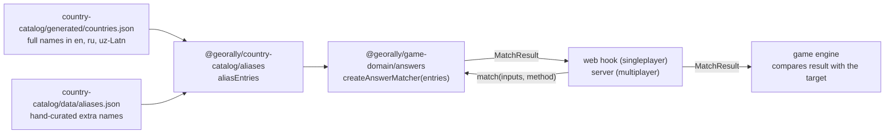

# Answer matching

The Name It mode shows a country on the map and asks the player to name it, by typing or by speaking.

## Overview



- The catalog combines the registry's country names with the alias file into a flat list of entries.
- `createAnswerMatcher(entries)` builds the lookup table once; `match(inputs, method)` answers each attempt.
- The matcher never knows the target country. The caller (a web hook in singleplayer, the server in multiplayer) passes the `MatchResult` to the game engine, which only compares `result.countryId` with the target. Engines stay pure and need no data files.
- In multiplayer the server runs the matcher, because it has the final say on scores. In singleplayer it runs in the browser. Both import the alias data through its own export path, so it can be loaded lazily when Name It starts.

## Contract

```ts
type AnswerLanguage = 'en' | 'ru' | 'uz'
type InputMethod = 'typing' | 'voice'

interface AliasEntry {
	countryId: CountryId
	text: string // raw: "O'zbekiston", "США"
	only?: InputMethod // a name that counts for one input method only
}

type MatchResult =
	| {
			kind: 'match'
			countryId: CountryId
			via: 'exact' | 'fuzzy'
			heard: string
	  }
	| { kind: 'ambiguous'; countryIds: CountryId[]; heard: string }
	| { kind: 'none'; heard: string }

interface AnswerMatcher {
	match(inputs: readonly string[], method: InputMethod): MatchResult
}
```

- `inputs` is the typed text, or the browser's speech alternatives in order of confidence.
- `heard` is the input that produced the result, trimmed, for the "Heard: …" feedback.
- `ambiguous` means the input names several countries: a shared name ("Congo"), or several countries in one utterance.
- `AliasEntry` has no `language` field. The matcher treats every language the same way (see [Languages](#languages)), so nothing would read it. If language-specific tables are ever needed, it comes back.

## Decisions

| Topic                 | Decision                                                                                                                                                                                  |
| --------------------- | ----------------------------------------------------------------------------------------------------------------------------------------------------------------------------------------- |
| Answer languages      | Every language is always accepted: English, Russian and Uzbek. There is no setting to restrict it, and the matcher takes no language input.                                               |
| Wrong keyboard layout | Not supported ("Hjccbz" typed for "Россия").                                                                                                                                              |
| Lookup table          | One combined table for every language. Each language's rules have their own file, but every rule applies to all text.                                                                     |
| Answer data           | Registry names, which are always accepted, plus hand-curated extra names in `aliases.json`. Nothing is generated.                                                                         |
| Display and answers   | The reveal shows the registry name, which is always an accepted answer, so the two can't drift apart. Short map labels ("Eq. Guinea") are not answers.                                    |
| Uzbek Cyrillic        | Accepted, through a forgiving fold to Latin applied to input only.                                                                                                                        |
| The target            | The matcher never sees it, so it can't favour the target when choosing between speech alternatives.                                                                                       |
| Typing                | Enter submits. An exact match of the target is accepted without Enter, unless it is the start of another country's name (see [Accepting while typing](#accepting-while-typing)).          |
| Voice                 | Push-to-talk, one utterance per press. No continuous recording, and no automatic start on each question.                                                                                  |
| Abbreviations         | Those that are also ordinary words (US, CAR, JAR, BAA) count for typing only.                                                                                                             |
| Classroom             | Typing only by default.                                                                                                                                                                   |

## Answer data

### Registry names

The build pipeline writes one full common name per language for each playable country into `country-catalog/generated/countries.json` (sources and validation are in [`data-pipeline.md`](data-pipeline.md)). The catalog loader turns each into an entry, so every name the game ever displays is accepted. The registry's languages are the app's locale tags (`en`, `ru`, `uz-Latn`); the loader maps the matcher's `uz` to `uz-Latn` through a typed record, so adding a language without a mapping fails to compile.

Map labels in the tiles are a separate field and are not answers. They contain abbreviations ("Eq. Guinea", "St. Vin. and Gren.") that would create false typo matches: "New Guinea" is two edits from "eq guinea", and used to match Equatorial Guinea.

### The alias file

`packages/country-catalog/data/aliases.json` holds only names the registry doesn't already provide, keyed by country id:

```json
{
	"840": {
		"en": ["United States of America", "USA", "America"],
		"ru": [
			"Соединённые Штаты Америки",
			"Соединённые Штаты",
			"Америка",
			"Штаты"
		],
		"uz": ["AQSh", "Amerika", "Qo'shma Shtatlar"],
		"typing": { "en": ["US"] }
	},
	"768": { "voice": { "en": ["to go"] } }
}
```

What belongs in it:

- **Short forms and everyday names:** USA, UK, Britain, DRC, UAE, Южная Корея, Amerika.
- **Official and former registry forms** that players still use: КНДР, Республика Корея, Королевство Нидерландов, ЮАР, United States of America.
- **Colloquial names that clearly mean the country:** England, Англия and Angliya for the United Kingdom; Holland, Голландия and Gollandiya for the Netherlands.
- **Recent former names:** Burma, Swaziland. Older historical names (Zaire, Ceylon, Persia, Siam) are left out.
- **Shared names under every country they belong to:** "Congo" (and "Конго", "Kongo") under both Congos, "Korea" (and "Корея", "Koreya") under both Koreas. A shared name is answered as `ambiguous`.
- **Typing-only abbreviations** under `typing`: abbreviations that are also ordinary words, "US" ("us"), "CAR" ("car"), and the Uzbek "JAR" ("jar") and "BAA" ("baa"). The voice scan looks for names inside whole sentences, so "it is one of us" would otherwise name the United States. Abbreviations that aren't words (USA, UK, UAE, РФ, ЮАР, AQSh) count for both methods, because players say them aloud and recognizers write them as letters.
- **Voice-only sound-alikes** under `voice`, used only for spoken answers: "to go" (Togo), "oh man" and "omen" (Oman), "i ran" (Iran), "chilly" (Chile), "hungry" (Hungary), "grease" (Greece), "molly" (Mali), "check republic" (Czech Republic). They are guesses and should be refined against real transcripts.

What doesn't belong: spelling variants that the cleanup already unifies (accents, apostrophes, hyphens, letter case, a leading "the"), and names identical to a registry name once cleaned.

The loader throws on an id that isn't a playable country. The data is static, so the error shows up on the first load in development or in the tests.

## Cleanup

Every alias and every input is turned into a lookup key by the same steps, so both sides always line up:

1. **Input only:** text containing Cyrillic is also tried folded from Uzbek Cyrillic to Latin, as an extra spelling. The fold must run before step 4, which would turn ў into у and lose the difference.
2. Unicode NFKC normalization.
3. `toLowerCase()`, not the locale-sensitive version, so results don't depend on the device.
4. NFD normalization, then every combining mark is removed: accents (Côte → cote), ё → е, й → и.
5. Apostrophes (`' ʻ ʼ ‘ ’` and the backtick) and periods are deleted, not replaced by spaces, so "U.S.A." becomes `usa` and "O'zbekiston", "Oʻzbekiston" and "Ozbekiston" become the same key.
6. `&` becomes `and`; every other character that isn't a letter or digit (dashes, commas, parentheses) becomes a space; spaces collapse.
7. Word rules: a leading "the" is dropped ("The Gambia" → `gambia`), and `st` becomes `saint` ("St Lucia").

Removing marks merges й with и and ё with е on both sides. That's intended. The only risk is two different names becoming one key, which the catalog test catches.

## Languages

The rules for each language live in their own file in `answers/languages/` (`en.ts`, `ru.ts`, `uz.ts`) and have the same shape: leading words to drop, word rewrites, and an optional input fold. They are combined and applied to all text, because the language of typed input is unknown: Latin text can be English or Uzbek, Cyrillic text can be Russian or Uzbek.

- **Benefit:** one table, one pass, and no language detection.
- **Drawback:** correctness depends on the rules never clashing across languages, and nothing in the design guarantees that. The catalog test catches fold collisions; a clash between rewrite rules is left to review, because only English has any.
- **If two rules ever genuinely conflict,** the fix is one table per language, which needs `language` back on entries.

**Uzbek Cyrillic fold.** It is forgiving rather than correct: Е always becomes `e`, although Uzbek writes `ye` at the start of a word and after a vowel; ц becomes `s`, щ becomes `sh`, ъ becomes an apostrophe (which the cleanup then deletes). A forgiving fold still lines up with the Latin names, while exact transliteration rules would only add misses. The build pipeline's Uzbek converter is the correct kind, and is deliberately not reused.

## Matching

`match()` runs two passes over the inputs: an exact pass over all of them, then a typo pass over all of them. An exact match in any input therefore beats a typo match in an earlier one.

### Exact matches

Each input is split into words and scanned for runs of consecutive words that are a known name, longest run first and then leftmost, skipping runs that overlap one already matched. "Bosnia and Herzegovina" is therefore found before "Bosnia".

- **Typing** must be covered completely: every word belongs to a matched name. "I think Chile" typed is not an answer.
- **Voice** may contain other words around the name ("I think it's Chile", "это Австралия"), because people don't answer with the bare name and recognizers add words. No list of filler words is needed: the scan ignores any word that isn't part of a name.
- **Several different countries** in one input ("Austria or Australia") return `ambiguous`. Otherwise a player could reel off names in one breath and let the scan pick the right one.
- **A name shared by several countries** returns `ambiguous` with all of them.
- No run is longer than the longest alias, so the scan's cost grows linearly with the length of a transcript.

**Spellings.** Each spelling of an input (the raw text, and the Uzbek fold of Cyrillic text) is scanned separately. Only the spellings whose matches cover the most words count; when equally good spellings disagree, the result is `ambiguous`. Without this rule, the folded spelling of "Конго-Браззавиль" ("kongo brazzavil", which only matches the shared "kongo") would make the raw spelling's clear match ambiguous.

### Typo matches

When no input matches exactly, a typed input's whole cleaned key, and every run of words in a spoken input, are compared with every key in the table using optimal string alignment distance. Spoken typos are therefore found among other words too ("umm Kazakstan maybe" → Kazakhstan). The distance counts an insertion, deletion, substitution or swap of two neighbouring characters as one edit each.

| Cleaned key length    | Typing tolerance | Voice tolerance |
| --------------------- | ---------------- | --------------- |
| 4 characters or fewer | 0                | 0               |
| 5–8                   | 1                | 0               |
| 9 or more             | 2                | 1               |

- **Measured on the cleaned key,** so punctuation and accents don't buy extra typos.
- **Short names get none,** because one edit turns them into another country: Iran/Iraq, Mali/Malta, Oman.
- **Voice gets one fewer.** A transcript is made of real words; its errors are misheard words, which edit distance doesn't model, and the voice-only aliases cover the common ones.
- **The closest country must be strictly closer than any other.** "Sambia" is one edit from both Gambia and Zambia, so it's `none`; the matcher won't guess. "Nigera" is one edit from both Niger and Nigeria, also `none`.
- **A typo of a shared name is `ambiguous`,** not `none`: "Kongoo" clearly means a Congo.
- **A stray space counts as a typo:** typing "to go" reaches Togo through `togo`, even though the voice-only alias "to go" isn't used for typing.
- **An exact name always wins:** "Niger" is Niger, even though it is close to Nigeria.
- **Every country is searched,** never only the target. Comparing only with the target would accept "Austria" (two edits from "australia") as Australia.

### Voice alternatives

Browsers return up to a few alternatives per utterance. They are tried in order, and the first one that produces `match` or `ambiguous` wins. The target is never favoured: if the browser's first guess is "Austria" and its second "Australia", the answer is Austria, whatever the target is.

## Using the result

The game decides: `isCorrect = result.kind === 'match' && result.countryId === targetId`. Wrong attempts cost only time.

Feedback for a wrong typed answer:

| Result                      | Message             |
| --------------------------- | ------------------- |
| another country, exact      | "Austria isn't it"  |
| another country, typo match | "Austrai → Austria" |
| nothing found               | "Don't know 'Xyz'"  |
| ambiguous                   | "Which Congo?"      |

Voice shows "Heard: …" with the text the browser returned.

### Accepting while typing

Because the score depends on time, an exact match of the target is accepted the moment it is typed, without Enter. Everything else still needs Enter: wrong countries, ambiguous names, nothing found, and every typo match. Typing gives no feedback until Enter, so the rule reveals nothing that Enter wouldn't.

One guard is needed. Some names are the start of another country's name: "niger" while typing "nigeria", "dominica" while typing "dominican republic", "guinea" while typing "guinea-bissau". Accepting immediately would credit a player who meant the longer, wrong name. So when the typed key is the start of another country's key, the answer is accepted only on Enter or after a short pause (600 ms). A longer name of the same country ("bosnia" in "bosnia and herzegovina") doesn't block.

The matcher provides both pieces: `matchAsTyped(text)` matches exactly (no typo pass) and returns `isPrefix` when the key is the start of another country's key. The web hook `useTypedAnswer` runs it on every keystroke and takes the mode's rule for what may be accepted early (`acceptsEarly`): Name It accepts only the target; Recall Sprint will accept any country it hasn't named yet.

## Input in the game

One answer bar for the whole game, at the bottom of the map on desktop and at the top on touch screens (`(pointer: coarse)`); the input itself is the floating bar, with the microphone inside its right edge on desktop. On touch screens the input sits at the top so iOS never scrolls the page to keep it above the keyboard (it scrolls only when a focused field would be covered), and the microphone is a separate button at the bottom centre, above the keyboard, where a thumb reaches it. It is never removed between rounds, because removing a focused input closes the phone keyboard, and closing and reopening it every round made iOS scroll the page, the screen snap back and the camera re-frame each time. Between rounds it stays focused but takes no input: during a flight it says "Get ready…"; on the reveal the input shows the country's name in heavier type, the bar's border, edge and outline turn green or coral, and a Next button replaces the microphone, and Enter (the keyboard's Go key) means Next. Its focus ring is a box shadow, not an outline: Safari draws outlines as rectangles, so their corners stuck out of the rounded bar. Nothing on the screen takes focus from it: the game screen cancels the pointer-down of every button inside it with one capture listener, so the map's own zoom, projection and info buttons keep the keyboard open as well as the game's, and the map's canvas loses the `tabindex` MapLibre gives it. Between rounds the input is `aria-readonly` for screen readers; it is never made truly read-only, because iOS hides the keyboard for a read-only field.

**Typing**

- The input is focused once, when the game screen opens (without scrolling, so the map doesn't move). Android usually opens the keyboard for it; iOS opens the keyboard only for a focus that follows a tap, so there it opens on the player's first tap and then stays open for the game. A player who closes the keyboard is left alone: nothing focuses the input again. The open keyboard counts as covered space, so the camera keeps the target above it.
- `autocomplete`, `autocorrect` and `autocapitalize` are off and `spellcheck` is false, so the phone doesn't "correct" Chad.
- On a wrong answer the bar shakes, the text stays selected so the next keystroke replaces it, and the feedback chip pops up above the bar. It stays until the player starts the next attempt (a keystroke or starting voice), then leaves with the same animation reversed: on a timer it would be missed by a player looking at the map or speaking, and kept longer it describes an answer the player has moved past.
- No autocomplete suggestions: they would turn recall into multiple choice.

**Voice**

- Started with the microphone button, or Enter in an empty input. Ctrl/⌘+Space and Alt+Shift switch keyboard layouts for Russian and Uzbek users, and the backtick key is ё on the Russian layout, so none of those are used.
- States: idle → listening (the interim transcript appears faintly in the bar) → final (submitted as a voice attempt) → feedback. Recognition stops after one final result; the next attempt needs another press. It is aborted when the round ends. Every way a session can end (its end event, an error, or `start()` throwing) resets the listening state, so the bar never stays on "Listening…".
- An interim transcript that is exactly the target, and not the start of another country's name, is accepted at once, by the same rule as typing. Safari's final result can lag by seconds, and the interim one usually has the name long before.
- The recognizer's language follows the UI language (`en` → `en-US`, `ru` → `ru-RU`, `uz-Latn` → `uz-UZ`). Uzbek is offered without checking support first: a browser that can't do it reports `language-not-supported` or `service-not-allowed`, which hides the microphone with a note, and the matcher accepts Uzbek in either script. There is no in-game language switch: it served few players, took the most valuable space above the keyboard, and its "EN" label read like a keyboard layout; a player who wants to speak another language switches the site's language, and the saved game carries over.
- Errors: a blocked microphone keeps typing available; silence shows "Didn't catch that"; a network error shows that voice needs internet; an unsupported language hides the microphone for it.

## Browser speech recognition

- The API is `SpeechRecognition`, prefixed `webkitSpeechRecognition` in Chrome and Safari. It needs HTTPS and must be started from a click or key press. Firefox doesn't support it, so the microphone is hidden there. Other iOS browsers (Chrome, Firefox, Edge, Opera) run on WebKit and expose the API without it working, so the microphone is hidden there too, detected by their user-agent tokens. `service-not-allowed` and `language-not-supported` mean voice doesn't work in that browser or language: the microphone is hidden with a note saying so, rather than blaming the microphone permission.
- Chrome and Edge send the audio to their cloud services, so voice needs internet. Safari uses Apple's dictation service.
- Settings used: `lang` (one language per session), `continuous = false`, `interimResults = true`, `maxAlternatives = 3` (browsers may return fewer).
- A result event exposes `results[i].isFinal`, `results[i][k].transcript` and `confidence`. Confidence differs between browsers and can be 0, so it is never used to accept or reject.
- Transcripts may start with a capital letter, end with a period (Safari) or start with a space. The cleanup handles all three.
- Errors: `not-allowed`, `service-not-allowed`, `no-speech`, `audio-capture`, `network`, `aborted`, `language-not-supported`.
- **Unverified:** how well `uz-UZ` is recognized in Chrome and Safari, and which script each returns.

## Deferred and not supported

- **Restricting answer languages,** for example a learning mode that accepts only the UI language. The matcher accepts everything; a restriction would be a check in the game, and needs `language` on results.
- **Russian grammatical cases** ("в Австралии") and wrong keyboard layouts.
- **Place names that contain a country name.** Voice accepts "Northern Ireland" as Ireland, "American Samoa" as Samoa, "New Mexico" as Mexico. The fix would be decoy entries that match no country and, being longer, win the scan. Not worth it until players actually say these.

## Testing

- **Domain tests** (`answers/*.test.ts`) use small made-up entry lists, so editing the real data never breaks them. They cover the cleanup rules, the distance function, and each matching rule above.
- **Catalog tests** (`country-catalog/src/aliases.test.ts`) run the real matcher on the real data:
   - every registry name and alias must resolve to its own country, typed and spoken, except the shared names, which must be ambiguous. This one check catches collisions between names, names that clean to nothing, and the Uzbek fold landing a Russian name on another country;
   - a handful of typos whose outcome depends on which other names exist (Austrai, Austrailia, Nigera, Sambia, Slovenija, Dominicana, Guinea Bisau, Конго-Браззавиль).

## Implementation notes

**Distance** (`distance.ts`)

- Returns the true distance or `maxSteps + 1`.
- Skips a pair outright when the lengths differ by more than `maxSteps`, and stops as soon as a whole row exceeds `maxSteps`, because later rows can only grow.
- Compares UTF-16 code units (string indexing); every country name is in the Basic Multilingual Plane, so surrogate pairs never occur.
- A full typo search over about 700 keys takes about 0.04 ms, against 0.7 ms for a full-table version.

**Typo search** (`fuzzy.ts`)

- The best distance found so far is passed as the cutoff for the remaining keys; ties are still found because the cutoff equals the best distance rather than one less.

**Lookup table** (`aliasTable.ts`)

- Names for both input methods, typing-only names and voice-only names are three separate maps; a lookup reads the shared map and its own method's map.
- It records the largest number of words in any key, which caps the voice scan.

## Code map

| File                                | Responsibility                                                 |
| ----------------------------------- | -------------------------------------------------------------- |
| `answers/types.ts`                  | The public types above                                         |
| `answers/normalize.ts`              | Steps 2–7 of the cleanup                                       |
| `answers/languages/`                | Each language's rules, combined in `index.ts`                  |
| `answers/candidates.ts`             | Turning raw input into words per spelling (fold) and word runs |
| `answers/aliasTable.ts`             | The lookup table built from entries                            |
| `answers/distance.ts`               | Optimal string alignment distance with a cutoff                |
| `answers/fuzzy.ts`                  | Typo tolerances and the closest-match rules                    |
| `answers/matcher.ts`                | The exact pass, the typo pass and the result                   |
| `country-catalog/data/aliases.json` | Extra names                                                    |
| `country-catalog/src/aliases.ts`    | Registry names and aliases as entries                          |
