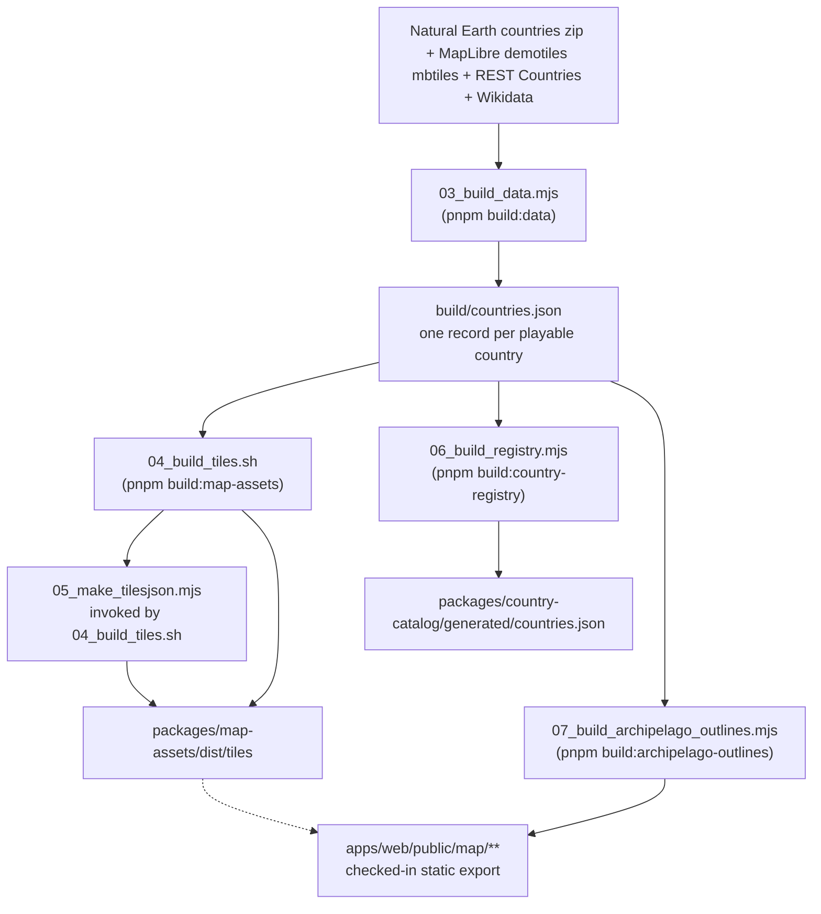

# Data & asset pipeline

`@georally/country-build` is an offline preparation package. It is not part of the normal web/server runtime, but it explains where the local country catalog and map files come from. It's invoked through root-level scripts: `pnpm build:data`, `pnpm build:country-registry`, `pnpm build:map-assets` and `pnpm build:archipelago-outlines`. Stages 01 and 02 have no root script and are run by hand from `packages/country-build`.



Stage 03 is the only stage that fetches data and the only one that validates it. It joins every source into one record per playable country, checks that nothing is missing, and only then writes. The later stages are projections of those records: 04 into map tiles, 06 into the catalog registry, 07 into archipelago outlines. None of them fills in a missing value.

## Stages

Run from `packages/country-build`, in this order. Intermediate files go to `build/` (gitignored); only stage 06's `--out-dir` and stage 04's `--tiles-dir` can be moved.

| Stage | Input | Output | Network |
| --- | --- | --- | --- |
| `01_get_fallback_sources.sh` | none | `upstream/ne_110m_admin_0_countries.zip` | Natural Earth (`naciscdn.org`), only if the zip is missing; it's committed |
| `02_prepare_base.sh` → `02b_dump_base_country_tiles.sh` → `02c_merge_base_countries.mjs` | `upstream/maplibre.mbtiles` | `build/base_geolines_z0.geojson`, `build/base_centroids_z0.geojson`, one dump per zoom-6 tile in `build/tmp_base_country_tiles/`, `build/base_countries.geojson` | None; `tippecanoe-decode` / `tippecanoe-enumerate` in Docker |
| `03_build_data.mjs` (`pnpm build:data`) | `build/base_countries.geojson`, `build/base_centroids_z0.geojson`, the Natural Earth zip, `data/manual_overrides.json`, `data/playable_states_195.json` | `build/countries.json`, `build/countries_join.csv`, `build/geolines_join.csv`, `build/centroids.geojson`, `build/capitals.geojson`, `build/supplemental_countries.geojson`, `build/build_data_report.json` | REST Countries (`rc-countries`, paged 100 per request) and one Wikidata Query Service request (`wdqs-country-capital-names`) |
| `04_build_tiles.sh` → `05_make_tilesjson.mjs` (`pnpm build:map-assets`) | `upstream/maplibre.mbtiles` and the stage 03 outputs | `build/*.mbtiles`, `build/world_complete.mbtiles`, the `.pbf` tile directory and `tiles.json` | None; `tile-join` and `tippecanoe` in Docker, one container per call |
| `06_build_registry.mjs` (`pnpm build:country-registry`) | `build/countries.json` | `countries.json` in `--out-dir` | None |
| `07_build_archipelago_outlines.mjs` (`pnpm build:archipelago-outlines`) | `build/tmp_base_country_tiles` (the zoom-6 tile dump from 02b), `build/countries.json`, `data/playable_states_195.json` (the `archipelagos` buffers) | `apps/web/public/map/archipelagos.geojson` | None |

**Cache.** `scripts/lib/cache.mjs` keeps every API response in `build/cache/<key>.json` and reads it first: a run requests an API only when that file is missing, or when `COUNTRY_BUILD_REFRESH=1` is set (for example `COUNTRY_BUILD_REFRESH=1 pnpm build:data`). A request overwrites the file on success; if it fails (HTTP error, network error, or a 429 after the retries), the client falls back to the file when there is one. The Wikidata client sends a descriptive `User-Agent` and retries a 429 after `Retry-After`; the REST Countries client needs `RESTCOUNTRIES_API_KEY` in `packages/country-build/.env` only when it actually requests, and does not retry.

**Docker.** Stages 02 and 04 need the `tippecanoe:latest` image (`pnpm build:tippecanoe-image`, which clones and compiles tippecanoe 2.79.0). The wrappers in `tools/` start one container per call; `02b` decodes the zoom-6 tiles in one container, one `tippecanoe-decode` per CPU at a time.

**Skipping stage 02.** Its output depends only on `upstream/maplibre.mbtiles`, the 02 scripts and the tippecanoe image. `02_prepare_base.sh` writes `build/base.stamp` with a hash of those, and skips the stage when the stamp matches and its three outputs exist. Delete `build/base.stamp` to force a rebuild.

**Publishing tiles.** `pnpm build:map-assets` writes to `packages/map-assets/dist/tiles` (gitignored). The web app serves the checked-in copy in `apps/web/public/map/tiles`; mirror it after a rebuild with `rsync -a --delete packages/map-assets/dist/tiles/ apps/web/public/map/tiles/`.

## Sources and joins

Stage 03 builds a record for each of the 195 countries in `data/playable_states_195.json`. Non-playable features on the map keep their geometry and nothing else: the map never shows text for them.

- **Identity.** A country's id is its ISO 3166 numeric code: the `isoN3` override, then Natural Earth's `ISO_N3` / `UN_A3` / `ADM0_A3_UN`, then REST Countries by alpha-3. Natural Earth uses its own `ADM0_A3` codes (`SDS` for South Sudan, `PSX` for Palestine), so every source is joined through the numeric id: REST Countries by `ccn3`, and Wikidata by REST Countries' ISO alpha-3.
- **Names** (shown in the UI and accepted as answers): an override, then REST Countries' common name (`names.common`, and the `rus` translation for Russian), then the Wikidata label. Uzbek has no REST Countries translation, so it comes from Wikidata only. When Wikidata has several country entities for one code (Palestine), a name from it counts as missing.
- **Labels** (drawn on the map): an override, then for English the base tiles' own cartographic label ("Eq. Guinea", "Antigua and Barb."), then the name.
- **Capitals.** The capital is REST Countries' primary capital (its English name and coordinates). Its Russian and Uzbek names come from the Wikidata capital whose English label matches, compared without case, accents or punctuation. A country with several capitals on Wikidata (South Africa, Yemen, Eswatini) therefore gets the same city in every language. Without a match, the name counts as missing.
- **Currencies.** REST Countries gives the currency code: the first code alphabetically when a country has several, unless the `currencyCode` override picks one. Names and symbols come from `Intl` (`Intl.DisplayNames` with `fallback: 'none'`, and `Intl.NumberFormat` with `currencyDisplay: 'narrowSymbol'`) in each language, at build time, so the output doesn't depend on the browser. A currency without a symbol shows its code ("TJS"). The build fails if Node's ICU has no names for a language.
- **Uzbek apostrophes** are normalized to the proper characters: `ʻ` after o and g (Oʻzbekiston), `ʼ` everywhere else.

## Validation

Every playable country must have, in all three languages, a name, a label, a capital and a currency name. It must also have a three-digit unique id, capital coordinates, a game continent, a population, a flag URL, and sovereignty and UN membership flags. Stage 03 collects every problem, prints them all, and exits with code 1 before writing any file. Nothing falls back to another language or a placeholder: a gap is fixed with an override in `data/manual_overrides.json`.

## Overrides

`data/manual_overrides.json` holds only decisions the sources can't make, keyed by Natural Earth `ADM0_A3`:

```json
{
	"countries": {
		"CIV": { "name": { "en": "Côte d'Ivoire" } },
		"MNG": { "capital": { "name": { "en": "Ulaanbaatar" } } },
		"PSX": {
			"name": { "uz-Latn": "Falastin" },
			"capital": {
				"name": { "en": "Jerusalem", "ru": "Иерусалим", "uz-Latn": "Quddus" },
				"coordinates": [35.2137, 31.7683]
			},
			"currencyCode": "ILS"
		}
	},
	"geolines": {
		"Equator": { "en": "Equator", "ru": "Экватор", "uz-Latn": "Ekvator" }
	}
}
```

`name`, `label` and `capital.name` override single languages; the rest still come from the sources. A capital override with every language skips the Wikidata match. `geolines` labels the base tiles' geolines, keyed by their original `name`.

## Build outputs

### Map tiles

`tiles.json` lists the layers and fields of the actual tiles: `05_make_tilesjson.mjs` reads them from the `metadata.json` that `tile-join` writes and removes that file. Every property is a string. Text properties follow `label_<language>`, with the language tag lowercased and `-` turned into `_`.

| Layer | Features | Properties |
| --- | --- | --- |
| `countries` | every base country, plus playable countries missing from the base | `adm0_a3` (Natural Earth's code) on every country; `iso_n3` on playable countries, an empty string on the rest |
| `centroids` | playable countries | `iso_n3`, `label_en`, `label_ru`, `label_uz_latn` |
| `capitals` | playable countries' capitals | `iso_n3`, `label_en`, `label_ru`, `label_uz_latn` |
| `geolines` | the base geolines except the International Date Line, which the map never draws | `label_en`, `label_ru`, `label_uz_latn` |

`04_build_tiles.sh` drops the base tiles' own attributes (`ADM0_A3`, `ABBREV`, `CONTINENT`, `NAME`, `fid`, and the geolines' `name`) with `tile-join -x` once the joins have used them, and drops the date line with a `tile-join -j` feature filter. The join CSVs quote every non-empty value, so `tile-join` keeps ids like `250` as strings instead of numbers; an empty value stays unquoted, because `tile-join` reads a quoted empty field as a literal `"`. `style.json` colours countries by `adm0_a3`, which is why every country keeps it, playable or not. The style reads every map text from these properties; the catalog never supplies map text.

### Registry

`packages/country-catalog/generated/countries.json` lists the playable countries, already in the shape of the catalog's `CountryInfo` type:

```json
{
	"id": "860",
	"name": { "en": "Uzbekistan", "ru": "Узбекистан", "uz-Latn": "Oʻzbekiston" },
	"capital": { "en": "Tashkent", "ru": "Ташкент", "uz-Latn": "Toshkent" },
	"currency": {
		"code": "UZS",
		"name": { "en": "Uzbekistani Som", "ru": "узбекский сум", "uz-Latn": "Oʻzbekiston soʻmi" },
		"symbol": { "en": "UZS", "ru": "UZS", "uz-Latn": "soʻm" }
	},
	"continent": "asia",
	"difficulty": "medium",
	"population": 39047321,
	"centroidLng": 62.666016,
	"centroidLat": 42.293564,
	"flagUrl": "https://flags.restcountries.com/v5/svg/uz.svg",
	"independent": true,
	"unMember": true
}
```

Localized fields are keyed by the app's locale tags, so the web app reads `country.name[language]` directly.

### Other outputs

- `packages/map-assets/dist/tiles` — the generated vector tiles and `tiles.json`, written by `pnpm build:map-assets`, which passes `--tiles-dir` and `--tiles-url-template /map/tiles/{z}/{x}/{y}.pbf` down to `country-build`. This `dist/` directory is gitignored.
- `apps/web/public/map/archipelagos.geojson` — outlines around countries spread over many small islands, one MultiPolygon per country with an `iso_n3` property. `archipelagos` in `data/playable_states_195.json` lists the countries with a buffer in km: islands closer than twice the buffer merge into one shape that follows the island chain, and a part around a lone island is dropped. The map draws them under the country fills, as a pickable area with an outline.
- `apps/web/public/map/**` — a static export (style.json, vector tiles, glyph PBFs) that _is_ checked into the repo and served directly by the web app.

## Invocation

| Root script | Wraps | Produces |
| --- | --- | --- |
| `pnpm build:data` | `@georally/country-build`'s `build:data` script (`node --env-file=.env scripts/03_build_data.mjs`) | `build/countries.json` and the tile inputs |
| `pnpm build:country-registry` | `@georally/country-build`'s `build:registry` script (`node scripts/06_build_registry.mjs`) | `packages/country-catalog/generated/countries.json` |
| `pnpm build:map-assets` | `@georally/country-build`'s `build:tiles` script (`bash scripts/04_build_tiles.sh`) | `packages/map-assets/dist/tiles/**` |
| `pnpm build:archipelago-outlines` | `@georally/country-build`'s `build:outlines` script (`node scripts/07_build_archipelago_outlines.mjs`) | `apps/web/public/map/archipelagos.geojson` |
