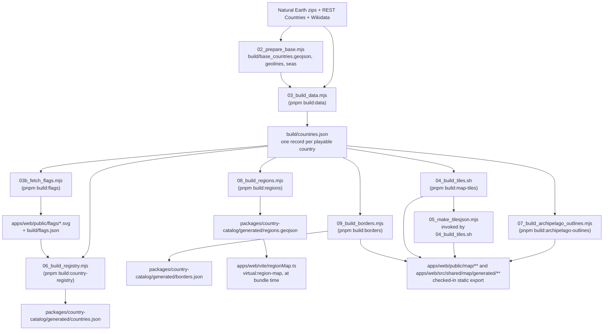

# Data & asset pipeline

`@georally/country-build` is an offline preparation package. It is not part of the normal web/server runtime, but it explains where the local country catalog and map files come from. It's invoked through root-level scripts: `pnpm build:data`, `pnpm build:country-registry`, `pnpm build:regions`, `pnpm build:map-tiles`, `pnpm build:archipelago-outlines` and `pnpm build:borders`. Stages 01 and 02 have no root script and are run by hand from `packages/country-build`.



Stage 03 is the only stage that fetches country data and the only one that validates country records; stage 09 validates borders (see [Borders](#borders)). Stage 03b fetches the flag images that 03 points to, and checks the files themselves (see [Flags](#flags)). It joins every source into one record per playable country, checks that nothing is missing, and only then writes. The later stages are projections of those records: 04 into map tiles, 06 into the catalog registry, 07 into archipelago outlines, 08 into continent shapes, 09 into the border graph. None of them fills in a missing value.

## Stages

Run from `packages/country-build`, in this order. Intermediate files go to `build/` (gitignored).

**Outputs stay inside the package unless told otherwise.** Every stage that produces a deliverable (03b, 04, 06, 07, 08, 09) takes `--out <directory>` and writes into `dist/` (or `dist/tiles` for 04) inside the package by default; no script knows where other packages live. Only the root scripts in `package.json` choose destinations elsewhere in the repo. Stages 03b and 04 empty their output directory first.

| Stage                                                                   | Input                                                                                                                | Output                                                                                                                                                                                         | Network                                                                                                                                                                        |
| ----------------------------------------------------------------------- | -------------------------------------------------------------------------------------------------------------------- | ---------------------------------------------------------------------------------------------------------------------------------------------------------------------------------------------- | ------------------------------------------------------------------------------------------------------------------------------------------------------------------------------ |
| `01_get_sources.sh`                                                     | none                                                                                                                 | the Natural Earth zips in `upstream/` (see [Sources and joins](#sources-and-joins))                                                                                                            | Natural Earth (`naciscdn.org`), only for a zip that is missing; they're committed                                                                                              |
| `02_prepare_base.mjs`                                                   | the 1:10m zips in `upstream/`                                                                                        | `build/base_countries.geojson`, `build/geolines.geojson`, `build/seas.geojson`                                                                                                                 | None                                                                                                                                                                           |
| `03_build_data.mjs` (`pnpm build:data`)                                 | `build/base_countries.geojson`, `build/seas.geojson`, `data/manual_overrides.json`, `data/playable_states_195.json`  | `build/countries.json`, `build/countries_join.csv`, `build/geolines_join.csv`, `build/centroids.geojson`, `build/capitals.geojson`, `build/sea_labels.geojson`, `build/build_data_report.json` | REST Countries (`rc-countries`, paged 100 per request) and two Wikidata Query Service requests (`wdqs-country-capital-names`, and `wdqs-sea-names-<hash>` for the seas' names) |
| `03b_fetch_flags.mjs` (`pnpm build:flags`)                              | `build/countries.json` (each country's `flagUrl`)                                                                    | `<id>.svg` per country in `--out`, `build/flags.json`                                                                                                                                          | The flag SVGs from `flags.restcountries.com`, cached in `build/cache/flags/<id>.svg`                                                                                           |
| `04_build_tiles.sh` → `05_make_tilesjson.mjs` (`pnpm build:map-tiles`)  | the stage 02 and 03 outputs                                                                                          | one `build/layer_<name>.mbtiles` per layer, `build/world.mbtiles`; the `.pbf` tile directory and `tiles.json` in `--out`                                                                       | None; `tile-join` and `tippecanoe` in Docker, one container per call                                                                                                           |
| `06_build_registry.mjs` (`pnpm build:country-registry`)                 | `build/countries.json`, `build/flags.json`                                                                           | `countries.json` in `--out`                                                                                                                                                                    | None                                                                                                                                                                           |
| `07_build_archipelago_outlines.mjs` (`pnpm build:archipelago-outlines`) | `build/base_countries.geojson`, `build/countries.json`, `data/playable_states_195.json` (the `archipelagos` buffers) | `archipelagos.geojson` in `--out`                                                                                                                                                              | None                                                                                                                                                                           |
| `08_build_regions.mjs` (`pnpm build:regions`)                           | `upstream/ne_110m_admin_0_countries.zip`, `build/countries.json`                                                     | `regions.geojson` in `--out`                                                                                                                                                                   | None                                                                                                                                                                           |
| `09_build_borders.mjs` (`pnpm build:borders`)                           | `build/base_countries.geojson`, `build/countries.json`, `data/border_overrides.json`                                 | `borders.json` in `--out`, `border-crossings.json` in `--crossings-out`, `build/borders_report.json`                                                                                           | None                                                                                                                                                                           |

**Cache.** `scripts/lib/cache.mjs` keeps every API response in `build/cache/<key>.json` and reads it first: a run requests an API only when that file is missing, or when `COUNTRY_BUILD_REFRESH=1` is set (for example `COUNTRY_BUILD_REFRESH=1 pnpm build:data`). A request overwrites the file on success; if it fails (HTTP error, network error, or a 429 after the retries), the client falls back to the file when there is one. Flags follow the same rules, as raw SVG files in `build/cache/flags/`. The Wikidata client sends a descriptive `User-Agent` and retries a 429 after `Retry-After`; the REST Countries client needs `RESTCOUNTRIES_API_KEY` in `packages/country-build/.env` only when it actually requests, and does not retry.

**Docker.** Only stage 04 needs the `tippecanoe:latest` image (`pnpm build:tippecanoe-image`, which clones and compiles tippecanoe 2.79.0). The wrappers in `tools/` start one container per call.

**Strict inputs.** `scripts/lib/natural-earth.mjs` reads a zip from `upstream/` and fails when it is missing or holds more than one shapefile. Stage 02 fails, before writing anything, when a country has no `ADM0_A3`, appears twice, isn't a polygon or has no label point, or when a geographic line or sea has the wrong geometry or no name.

## Sources and joins

Stage 03 builds a record for each of the 195 countries in `data/playable_states_195.json`. Non-playable features on the map keep their geometry and nothing else: the map never shows text for them.

The map and the game read one geometry: Natural Earth's 1:10m countries, in the variant with boundary lakes cut out (`ne_10m_admin_0_countries_lakes`), so Lake Victoria or Lake Tanganyika shows as water and a border across a lake isn't a land border. It has 258 features, every playable country among them. It replaced the MapLibre demotiles, whose countries are Natural Earth too but came only as zoom-6 tiles, so the build had to decode every tile and stitch the pieces back together. The other 1:10m layers are the geographic lines (the date line is left out, since the map never draws it) and the marine areas Natural Earth labels at zoom 6 or lower. Rivers were tried and dropped: on the pastel country fills they read as veins, and the game is about countries. Only the region picker (stage 08) still reads the 1:110m countries, since it needs a small outline.

- **Identity.** A country's id is its ISO 3166 numeric code: the `isoN3` override, then Natural Earth's `ISO_N3` / `UN_A3` / `ADM0_A3_UN`, then REST Countries by alpha-3. Natural Earth uses its own `ADM0_A3` codes (`SDS` for South Sudan, `PSX` for Palestine), so every source is joined through the numeric id: REST Countries by `ccn3`, and Wikidata by REST Countries' ISO alpha-3.
- **Names** (shown in the UI and accepted as answers): an override, then REST Countries' common name (`names.common`, and the `rus` translation for Russian), then the Wikidata label. Uzbek has no REST Countries translation, so it comes from Wikidata only. When Wikidata has several country entities for one code (Palestine), a name from it counts as missing.
- **Labels** (drawn on the map): an override, then for English Natural Earth's short `NAME` ("Eq. Guinea", "Antigua and Barb."), then the name. A label sits at Natural Earth's label point (`LABEL_X`, `LABEL_Y`), placed by its cartographers for legibility rather than at the geometric centre. Where that point lies in the sea (Equatorial Guinea, São Tomé and Príncipe, Antigua and Barbuda, Trinidad and Tobago, St Vincent, New Zealand), stage 02 replaces it with the pole of inaccessibility of the nearest part, so a ring or marker on it lands on the country. Our own centres for every country were tried and rejected: a centre of mass falls outside concave or scattered countries (France's lands in the Atlantic), and the pole of inaccessibility moves to the widest bulge (northern Chile). The label point is also the point the camera and the reveal popup aim at (`centroidLng`, `centroidLat`). Its `LABELRANK` becomes the tiles' `rank`, which the style uses as `symbol-sort-key`, so where labels collide the bigger country wins.
- **Sea labels.** English and Russian come from Natural Earth (`name_en`, `name_ru`), and Uzbek from the Wikidata item each sea names (`wikidataid`), whose `uz` label is used unless it is in Cyrillic. Wikidata's Russian labels only fill gaps: they carry disambiguation such as "Маккензи (залив)". A sea with no name in a language has no label in that language: 92 of the 192 have no Uzbek name today. Natural Earth splits the Atlantic and the Pacific at the equator and names both halves alike, so the `seas` overrides name them North and South in all three languages. The label point is the pole of inaccessibility (`polylabel`) of the sea's largest part.
- **Capitals.** The capital is REST Countries' primary capital (its English name and coordinates). Its Russian and Uzbek names come from the Wikidata capital whose English label matches, compared without case, accents or punctuation. A country with several capitals on Wikidata (South Africa, Yemen, Eswatini) therefore gets the same city in every language. Without a match, the name counts as missing.
- **Currencies.** REST Countries gives the currency code: the first code alphabetically when a country has several, unless the `currencyCode` override picks one. Names and symbols come from `Intl` (`Intl.DisplayNames` with `fallback: 'none'`, and `Intl.NumberFormat` with `currencyDisplay: 'narrowSymbol'`) in each language, at build time, so the output doesn't depend on the browser. A currency without a symbol shows its code ("TJS"). The build fails if Node's ICU has no names for a language.
- **Geometry** is `build/base_countries.geojson`, the same features the tiles draw. Stage 03 also records Natural Earth's `SUBREGION` and `LABELRANK` (as `subregion` and `labelRank`) in `build/countries.json`; the catalog doesn't carry them yet.
- **Bounds** frame a country's main body for the camera, not every territory it owns: France without its overseas departments, the United States without Alaska and Hawaii, Norway without Svalbard. The box starts from the parts containing the label point and the capital (or the parts nearest to them, when an offshore label point or capital lies in the sea) and the points themselves, then repeatedly takes in any part within 2° of it, which keeps archipelagos such as the Maldives or Micronesia whole. Longitudes are taken relative to the label point, so a country crossing the antimeridian stays contiguous: `west` is in [-180, 180) and `east` exceeds 180 when the box crosses it (Russia ends at 191, Fiji at 181.8), which MapLibre's `fitBounds` accepts as is. Values are rounded outward to 4 decimals.
- **Uzbek apostrophes** are normalized to the proper characters: `ʻ` after o and g (Oʻzbekiston), `ʼ` everywhere else.

## Validation

Every playable country must have, in all three languages, a name, a label, a capital and a currency name. It must also have a three-digit unique id, capital coordinates, ordered and finite bounds, a game continent, a population, a flag URL, and sovereignty and UN membership flags. Stage 03 collects every problem, prints them all, and exits with code 1 before writing any file. Nothing falls back to another language or a placeholder: a gap is fixed with an override in `data/manual_overrides.json`.

## Overrides

`data/manual_overrides.json` holds only decisions the sources can't make, keyed by Natural Earth `ADM0_A3`:

```json
{
	"countries": {
		"CIV": { "name": { "en": "Côte d'Ivoire" } },
		"MNG": { "capital": { "name": { "en": "Ulaanbaatar" } } },
		"PSX": {
			"name": { "uz-Latn": "Falastin" },
			"capital": {
				"name": {
					"en": "Jerusalem",
					"ru": "Иерусалим",
					"uz-Latn": "Quddus"
				},
				"coordinates": [35.2137, 31.7683]
			},
			"currencyCode": "ILS"
		}
	},
	"geolines": {
		"Equator": { "en": "Equator", "ru": "Экватор", "uz-Latn": "Ekvator" }
	}
}
```

`name`, `label` and `capital.name` override single languages; the rest still come from the sources. A capital override with every language skips the Wikidata match. `seas` names a marine area in every language, keyed by its Natural Earth `ne_id`; the build fails when the id matches no sea. `geolines` labels Natural Earth's geographic lines, keyed by their `name`.

## Build outputs

### Map tiles

`tiles.json` (in `apps/web/src/shared/map/generated/`, written where `--tilejson-out` says; next to the tiles without it) lists the layers and fields of the actual tiles: `05_make_tilesjson.mjs` reads them from the `metadata.json` that `tile-join` writes and removes that file. Ids and text are strings; `rank` is a number. Text properties follow `label_<language>`, with the language tag lowercased and `-` turned into `_`.

**Cache busting.** nginx serves tiles with `Cache-Control: public, max-age=31536000, immutable`, so browsers never ask for a tile URL again once they have it. `05_make_tilesjson.mjs` therefore appends `?v=<hash>` to the tile URL template, where the hash covers every `.pbf` file's path and bytes. `tiles.json` is bundled into the hashed JS (`shared/map/mapStyle.ts` inlines its tile template into the style's `world` source), so after a rebuild the next deploy's JS carries the new URLs; an unchanged tile set keeps the same hash. The map fonts are also `immutable` under fixed URLs: if the glyph files ever change, version `GLYPHS_URL` in `apps/web/src/shared/map/map-styles.tsx` the same way.

**Compression.** tippecanoe writes the tiles gzipped, so nginx sends them as they are with `Content-Encoding: gzip` and must never compress them again (`gzip off`, `gzip_static off` on that location). Everything else is compressed once at build time: the `precompress` Vite plugin (`apps/web/vite/precompress.ts`) writes a `.gz` next to every JS, CSS, HTML, JSON, GeoJSON, SVG and glyph PBF over 1 KB that shrinks by at least 10%, and nginx's `gzip_static` sends that file to clients that accept gzip. On-the-fly `gzip` stays on for anything without a `.gz` (API responses); `application/x-protobuf` is left out of its types, so a tile can't get a second layer.

| Layer       | Features                                                            | Properties                                                                                                     |
| ----------- | ------------------------------------------------------------------- | -------------------------------------------------------------------------------------------------------------- |
| `countries` | every base country                                                  | `adm0_a3` (Natural Earth's code) on every country; `iso_n3` on playable countries, an empty string on the rest |
| `centroids` | playable countries, at their label points                           | `iso_n3`, `rank`, `label_en`, `label_ru`, `label_uz_latn`                                                      |
| `capitals`  | playable countries' capitals                                        | `iso_n3`, `label_en`, `label_ru`, `label_uz_latn`                                                              |
| `geolines`  | the geographic lines except the date line                           | `label_en`, `label_ru`, `label_uz_latn`                                                                        |
| `seas`      | one point per marine area, from the zoom Natural Earth labels it at | `kind` (`ocean`, `sea`, `bay`…), `rank`, `label_en`, `label_ru`, `label_uz_latn`                               |

`04_build_tiles.sh` builds each layer with tippecanoe from zoom 0 to 6. Countries use `--detect-shared-borders`, so neighbours are simplified along the same line and no gap opens between them, and `--no-tiny-polygon-reduction`, so microstates keep their real shape. Point layers keep every feature (`-r1 -pf`). The countries and geolines keep only Natural Earth's `ADM0_A3` and `name`; `tile-join -c` adds the game's codes and labels from the join CSVs, and `-x` drops the key. Zoom 6 already carries the full 1:10m detail: its vertices are 1.5–2.5 km apart, and a zoom-6 tile resolves about 150 m. The tiles total 3.7 MB, against 3.8 MB for the demotiles-based set they replaced. The join CSVs quote every non-empty value, so `tile-join` keeps ids like `250` as strings instead of numbers; an empty value stays unquoted, because `tile-join` reads a quoted empty field as a literal `"`. `style.json` colours countries by `adm0_a3`, which is why every country keeps it, playable or not. The style reads every map text from these properties; the catalog never supplies map text.

### Registry

`packages/country-catalog/generated/countries.json` lists the playable countries, already in the shape of the catalog's `CountryInfo` type:

```json
{
	"id": "860",
	"name": { "en": "Uzbekistan", "ru": "Узбекистан", "uz-Latn": "Oʻzbekiston" },
	"capital": { "en": "Tashkent", "ru": "Ташкент", "uz-Latn": "Toshkent" },
	"currency": {
		"code": "UZS",
		"name": {
			"en": "Uzbekistani Som",
			"ru": "узбекский сум",
			"uz-Latn": "Oʻzbekiston soʻmi"
		},
		"symbol": { "en": "UZS", "ru": "UZS", "uz-Latn": "soʻm" }
	},
	"continent": "asia",
	"difficulty": "medium",
	"population": 39047321,
	"centroidLng": 62.666016,
	"centroidLat": 42.293564,
	"bounds": [55.9753, 37.1854, 73.1484, 45.5583],
	"flagUrl": "/flags/860.svg?v=1f0c2a9e",
	"independent": true,
	"unMember": true
}
```

Localized fields are keyed by the app's locale tags, so the web app reads `country.name[language]` directly.

### Regions

`packages/country-catalog/generated/regions.geojson` holds one feature per game continent, with a `continent` property and the continent's merged outline in longitude and latitude. It's raw data: no projection, size, rounding or removal of small islands.

- Shapes are Natural Earth 1:110m countries. Playable countries take the continent the game gives them (`build/countries.json`); every other shape gets `canonicalizeContinent`, which throws on anything it doesn't know, so no shape can go missing silently. Antarctica is left out because it isn't a game scope.
- Countries are merged per continent on their shared borders (`topojson-server` and `topojson-client`), which dissolves internal borders exactly. Before merging, `geoStitch` removes Natural Earth's cuts along the 180° meridian, so Chukotka and Fiji stay whole.
- The geometry follows d3-geo's spherical conventions: outer rings wind clockwise, and shapes may cross the 180° meridian. Tools that expect RFC 7946 GeoJSON would need to rewind and split it.

The catalog exports the file as `@georally/country-catalog/regions.geojson`, and its index never imports it, so no runtime code loads it. The web app's Vite plugin `apps/web/vite/regionMap.ts` reads it at bundle time and serves the `virtual:region-map` module: SVG paths per continent and their `viewBox`. The projection (Equal Earth, rotated 11° so the seam falls in the Bering Strait), the 800 px width, the removal of islands smaller than 3 px² and the rounding all live there, and the browser receives only finished path strings. The paths are not simplified: a simplified version, smoothed or not, looked crude next to the detailed game map. `RegionPicker` colours each continent from its own palette of six vivid colours, since the app's theme has only five hues and a repeated colour made two continents look like one choice.

### Flags

Flags are served from our own origin, so the service worker can precache them and offline play shows them (see [`pwa.md`](pwa.md)). The source is REST Countries' flag CDN, whose artwork is mostly public-domain Wikimedia flags. Stage 03 records each country's REST Countries URL. Stage 03b downloads the files, checks them and writes `apps/web/public/flags/<id>.svg` (checked in, like the tiles). Stage 06 then puts `/flags/<id>.svg?v=<hash>` into the catalog, where the hash is the first 8 hex digits of the file's SHA-256. The URL changes only when the file does, so nginx can cache flags as `immutable`. Stage 06 fails if a country has no flag, so it can't silently run against an old 03b output.

- **Served as downloaded.** The files are byte-identical to the source, and gzip (`precompress`, nginx `gzip_static`) does the compression. SVGO was tried and dropped. At the precision where no flag changed visibly, it cut the gzipped total only from 1026 KB to 854 KB. Its rounding is the only lossy step, and lower precision damaged real flags: Australia, New Zealand and Tuvalu draw the Union Jack's diagonals inside `scale(840)` with stroke widths of .4 and .6, so rounding to the root `viewBox` removed the red saltire, and Korea's yin-yang arcs span exactly a diameter, so a 0.01 rounding moved the circle. Staying safe needed a precision per flag from the transforms and a pixel comparison after every refresh, which 160 KB doesn't justify. SVGO stays as the XML parser for the checks.
- **Sizes.** 195 flags: 2.7 MB, 1026 KB gzipped (the precache downloads them gzipped). Most are a few KB. The emblem flags are the large ones: El Salvador 243 KB, Bolivia 235 KB, Afghanistan 217 KB, Ecuador 212 KB.
- **Checks.** A flag fails the build if its root element isn't `<svg>`, if it contains `<script>` or `<foreignObject>`, if it has an `on*` attribute or an `href` that isn't a local `#id`, or if it is larger than 300 KB (about 20% above the largest flag today, so a broken download or a much heavier redraw stands out). Inside `` an SVG can't run scripts or load anything. But the files are on our origin, so opening one directly would run its scripts with access to `localStorage`, which holds room session tokens. nginx therefore also serves `/flags/` with `Content-Security-Policy: default-src 'none'; style-src 'unsafe-inline'`.

### Borders

Two playable countries are neighbours when the map shows them touching, or a bridge or tunnel joins them, unless `data/border_overrides.json` says otherwise. Stage 09 measures this on `build/base_countries.geojson`, the same geometry the tiles draw, so a player never sees a border the game denies, or the reverse.

- **Measuring.** The countries go into a topology (`topojson-server`) without quantization, so the coordinates stay exact and two countries share an arc exactly where their outlines coincide. Two countries are neighbours when they share an arc (`topojson-client`'s `neighbors`); the shared boundary is `mesh` over the pair. Lengths are haversine km. Non-playable features (Western Sahara, Kosovo, Somaliland, Kashmir, Bir Tawil, the Southern Patagonian Ice Field) are part of the topology but are not nodes, so they block the borders across them.
- **Input check.** Stage 02 already guarantees unique `ADM0_A3` codes and polygon geometry. Stage 09 checks only that every playable country is in the base geometry, since a stale `build/countries.json` would otherwise leave a country silently without borders.
- **Overrides.** `data/border_overrides.json` has exactly two keys, `add` and `remove`, both lists of `{ a, b, reason }`, keyed by `ADM0_A3`; an added border may give its `crossing` point. The stage fails on any other key, and when an override names a non-playable country or the same country twice, has no reason, appears twice, or no longer changes anything (adding a border the geometry already has, removing one it doesn't), so a stale override can't linger. Today it adds Zambia–Botswana (the Kazungula border is about 150 m, and Natural Earth draws the two as touching at a point) and the four fixed links: the Channel Tunnel (UK–France), the Øresund Bridge (Denmark–Sweden), the Johor–Singapore Causeway and the King Fahd Causeway (Saudi Arabia–Bahrain). Ferries don't count.
- **Outputs.** `packages/country-catalog/generated/borders.json` is `{ version, generated_at, edges }`, each pair and the list sorted by id; the catalog exports it as a graph from `@georally/country-catalog/borders`. `apps/web/src/shared/map/generated/border-crossings.json` maps each measured border's id `"<a>-<b>"` to its crossing point `[lng, lat]`, the middle of the border's longest part (a border has several parts only where the border does: exclaves such as Nakhichevan, Alaska, Ceuta and Melilla, a lake in between). It is about 10 KB, one border per line, and the routes mode bundles it. A border added by an override uses the override's `crossing`; without one it has no entry, and the route line crosses midway between the two centroids. `build/borders_report.json` lists for review every border under 20 km, every pair that touches only at a point (Namibia–Zimbabwe, Zambia–Botswana), and every non-playable feature that touches two or more playable countries.
- **Rulings.** The geometry decides most surprising cases, and they are kept because they are real borders. The routes setup page explains them in a help note.
   - French Guiana is drawn as France, so France borders Brazil and Suriname.
   - Ceuta and Melilla join Spain to Morocco.
   - Kaliningrad joins Russia to Poland and Lithuania.
   - Cabinda joins Angola to the Republic of the Congo.
   - Nakhchivan joins Azerbaijan to Turkey.

   Non-playable features leave gaps: Kosovo between Serbia and Albania, Somaliland between Somalia and Djibouti, and Western Sahara between Morocco and Mauritania. Gibraltar and the UK bases on Cyprus give the UK no border with Spain or Cyprus. Namibia and Zimbabwe touch only at a point and get no border.

- **Today.** 315 borders among 158 countries; 37 playable countries have neither a land border nor a fixed link.
   - 156 of the 158 form one connected part. French Guiana is the only link between the Americas and the rest; Haiti and the Dominican Republic form the other part.
   - China and Russia have the most neighbours, 14 each.

### Other outputs

- `apps/web/public/map/tiles` — the generated vector tiles, written by `pnpm build:map-tiles`, which passes `--out`, `--tiles-url-template /map/tiles/{z}/{x}/{y}.pbf` and `--tilejson-out` (for `tiles.json`) down to `country-build`.
- `apps/web/src/shared/map/generated/archipelagos.geojson` — outlines around countries spread over many small islands, one MultiPolygon per country with an `iso_n3` property. `archipelagos` in `data/playable_states_195.json` lists the countries with a buffer in km: islands closer than twice the buffer merge into one shape that follows the island chain, and a part around a lone island is dropped. The map draws them under the country fills, as a pickable area with an outline.
- `apps/web/public/map/**` — a static export (vector tiles, glyph PBFs for Noto Sans Regular, Bold and Italic; the sea labels use Italic, which comes from the MapLibre demotiles font server, with only the ranges that Regular has glyphs for) that _is_ checked into the repo and served directly by the web app. The style (`apps/web/src/shared/map/style.json`), `tiles.json` and the archipelago outlines live under `src` instead, so Vite puts them into fingerprinted files that are cached forever, and the map needs no request for its style or tile list.

## Invocation

| Root script                       | Wraps                                                                                                  | Produces                                                                                                     |
| --------------------------------- | ------------------------------------------------------------------------------------------------------ | ------------------------------------------------------------------------------------------------------------ |
| `pnpm build:data`                 | `@georally/country-build`'s `build:data` script (`node --env-file=.env scripts/03_build_data.mjs`)     | `build/countries.json` and the tile inputs                                                                   |
| `pnpm build:flags`                | `@georally/country-build`'s `build:flags` script (`node scripts/03b_fetch_flags.mjs`)                  | `apps/web/public/flags/*.svg`, `build/flags.json`                                                            |
| `pnpm build:country-registry`     | `@georally/country-build`'s `build:registry` script (`node scripts/06_build_registry.mjs`)             | `packages/country-catalog/generated/countries.json`                                                          |
| `pnpm build:regions`              | `@georally/country-build`'s `build:regions` script (`node scripts/08_build_regions.mjs`)               | `packages/country-catalog/generated/regions.geojson`                                                         |
| `pnpm build:map-tiles`            | `@georally/country-build`'s `build:tiles` script (`bash scripts/04_build_tiles.sh`)                    | `apps/web/public/map/tiles/**`, `apps/web/src/shared/map/generated/tiles.json`                               |
| `pnpm build:archipelago-outlines` | `@georally/country-build`'s `build:outlines` script (`node scripts/07_build_archipelago_outlines.mjs`) | `apps/web/src/shared/map/generated/archipelagos.geojson`                                                     |
| `pnpm build:borders`              | `@georally/country-build`'s `build:borders` script (`node scripts/09_build_borders.mjs`)               | `packages/country-catalog/generated/borders.json`, `apps/web/src/shared/map/generated/border-crossings.json` |
