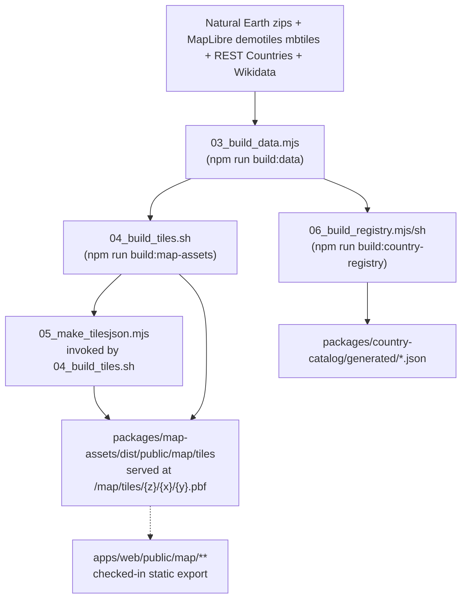

# Data & asset pipeline

`@georally/country-build` is an offline preparation package. It is not part of the normal web/server runtime, but it explains where the local country catalog and map files come from. It's invoked through root-level scripts: `pnpm build:data`, `pnpm build:country-registry` and `pnpm build:map-assets`. Stages 01 and 02 have no root script and are run by hand from `packages/country-build`.

`04_build_tiles.sh` runs the full tile pipeline (patching, filtering, and merging `.mbtiles` layers with the bundled `tippecanoe`/`tile-join` binaries) and, as its final step, invokes `05_make_tilesjson.mjs` itself — so one root script (`build:map-assets`) produces both the `.pbf` tiles and `tiles.json`.

## Stages

Run from `packages/country-build`, in this order. Intermediate files go to `build/` (gitignored); only stage 06's `--out-dir` and stage 04's `--tiles-dir` can be moved.

| Stage                                                                                    | Input                                                                                                                                                      | Output                                                                                                                                                                                                   | Network                                                                                                                                                    |
| ---------------------------------------------------------------------------------------- | ---------------------------------------------------------------------------------------------------------------------------------------------------------- | -------------------------------------------------------------------------------------------------------------------------------------------------------------------------------------------------------- | ---------------------------------------------------------------------------------------------------------------------------------------------------------- |
| `01_get_fallback_sources.sh`                                                             | none                                                                                                                                                       | `upstream/ne_110m_admin_0_countries.zip`, `upstream/ne_110m_populated_places.zip`                                                                                                                        | Natural Earth (`naciscdn.org`), only for a zip that is missing; both are committed                                                                         |
| `02_prepare_base.sh` → `02b_dump_base_country_tiles.sh` → `02c_merge_base_countries.mjs` | `upstream/maplibre.mbtiles`                                                                                                                                | `build/base_geolines_z0.geojson`, `build/base_centroids_z0.geojson`, one dump per zoom-6 tile in `build/tmp_base_country_tiles/`, `build/base_countries.geojson`                                         | None; `tippecanoe-decode` / `tippecanoe-enumerate` in Docker                                                                                               |
| `03_build_data.mjs` (`pnpm build:data`)                                                  | `build/base_countries.geojson`, `build/base_centroids_z0.geojson`, the Natural Earth zips, `data/manual_overrides.json`, `data/playable_states_195.json`   | `build/country_seed.json`, `build/join_adm0.csv`, `build/geolines_join.csv`, `build/centroids.geojson`, `build/capitals.geojson`, `build/supplemental_countries.geojson`, validation CSVs and audit JSON | REST Countries (`rc-tiles-data`, paged 100 per request) and Wikidata Query Service (country and capital labels in `en`, `ru`, `uz`), one request at a time |
| `04_build_tiles.sh` → `05_make_tilesjson.mjs` (`pnpm build:map-assets`)                  | `upstream/maplibre.mbtiles` and the stage 03 outputs                                                                                                       | `build/*.mbtiles`, `build/world_complete.mbtiles`, the `.pbf` tile directory and `tiles.json`                                                                                                            | None; `tile-join` and `tippecanoe` in Docker, one container per call                                                                                       |
| `06_build_registry.sh` → `06_build_registry.mjs` (`pnpm build:country-registry`)         | `build/country_seed.json`, `build/centroids.geojson`, `build/base_countries.geojson`, `build/supplemental_countries.geojson`, `data/manual_overrides.json` | `countries.registry.json`, `countries.playable.json`, `build/validator_registry_failures.csv`, `build/registry_build_report.json`                                                                        | REST Countries (`rc-registry-data`) and Wikidata Query Service (currency labels)                                                                           |

**Cache.** `scripts/lib/cache.mjs` keeps every API response in `build/cache/<key>.json`. It is a fallback, not a cache in front of the network: each run requests the APIs again, overwrites the file on success, and reads it only if a request fails (HTTP error, network error, or a 429 after the retries). The Wikidata client sends a descriptive `User-Agent` and retries a 429 after `Retry-After`; the REST Countries client needs `RESTCOUNTRIES_API_KEY` in `packages/country-build/.env` and does not retry.

**Docker.** Stages 02 and 04 need the `tippecanoe:latest` image (`pnpm build:tippecanoe-image`, which clones and compiles tippecanoe 2.79.0). The wrappers in `tools/` start one container per call.

## Build outputs

- `countries.registry.json` — the full generated country registry.
- `countries.playable.json` — the filtered playable subset used by the app. Uzbek Latin-script names come from Wikidata's `uz` labels, transliterated from Cyrillic where needed (`scripts/lib/uz-latn.mjs`), inside stages 03 and 06.
- `packages/map-assets/dist/public/map/tiles` — the generated vector tiles and `tiles.json`, written by `npm run build:map-assets`, which passes `--tiles-dir` and `--tiles-url-template /map/tiles/{z}/{x}/{y}.pbf` down to `country-build`. This `dist/` directory is gitignored — it's a build artifact, not checked into the repo.
- `apps/web/public/map/**` — a static export (style.json, vector tiles, glyph PBFs) that _is_ checked into the repo and served directly by the web app.

## Invocation

| Root script                      | Wraps                                                                                     | Produces                                              |
| -------------------------------- | ----------------------------------------------------------------------------------------- | ----------------------------------------------------- |
| `npm run build:data`             | `@georally/country-build`'s `build:data` script (`node scripts/03_build_data.mjs`)        | intermediate data used by the tile and registry steps |
| `npm run build:country-registry` | `@georally/country-build`'s `build:registry` script (`bash scripts/06_build_registry.sh`) | `packages/country-catalog/generated/*.json`           |
| `npm run build:map-assets`       | `@georally/country-build`'s `build:tiles` script (`bash scripts/04_build_tiles.sh`)       | `packages/map-assets/dist/public/map/tiles/**`        |
