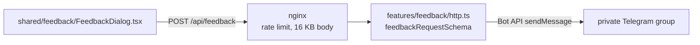

# Feedback

Players have two ways to tell us what they think:

- **The feedback form.** Written messages go to a private Telegram group. The form opens from the header, from "Report a problem" on the game and room error screens (preset to the bug category), and from "Tell us more" after a reaction.
- **The game reaction.** A one-tap rating with three choices after a finished game. It is a GA4 event (`game_reaction` with `mode` and `reaction`), so it never reaches the server. If the player then opens the form through "Tell us more", the message carries the reaction.

## Delivery

- **Telegram is the only record.** The server has no database ([`persistence.md`](persistence.md)), and its logs don't carry the message ([`logging.md`](logging.md)). If Telegram rejects the message or doesn't answer within 5 s, the message is lost on the server side: the client gets 503 `feedback_unavailable` and the form stays open with the text, so the player can send it again. The client waits 8 s, longer than the server's Telegram timeout, so the player sees the server's answer and not a client timeout.
- **Feedback is optional.** Without `TELEGRAM_BOT_TOKEN` and `TELEGRAM_FEEDBACK_CHAT_ID` the server still starts and answers every feedback request with 503 `feedback_unavailable`. Setting only one of the two fails startup. `server_started` logs `feedbackEnabled`.
- **Spam.** The form has a hidden `honeypot` field. When it is filled, the server returns 201 without sending anything, so a bot can't tell it was dropped. nginx allows 10 requests a minute per IP with a burst of 10: a class on one school IP can still write, while a script can't flood the group.
- **The message** has the category, the reaction, the text, the optional contact, the locale, the page path and the user agent. The schema also accepts `countryId` and `appVersion`, which the web app doesn't send yet.

## When the reaction shows

- **From the player's second finished game, then at most once a day per mode** (`locate`, `name_it`, `recall_sprint`, `multiplayer`). The first game is skipped because a first-time player can't compare it with anything yet. The once-a-day limit keeps it from becoming a chore for regular players.
- **Every finished game counts**, shown or not. The state is in `localStorage` under `georally.reactionPrompt` (`finishedGames` and the last time it was shown for each mode). When storage is blocked, the reaction never shows, so it can't appear after every game.
- **Locate, Name It and multiplayer** show it on the result screen. **Recall Sprint** ends on a review map with no room for it, so it shows when the player leaves the review: on the setup page, between the mode tabs and the settings, until the player answers or closes it.
- **The faces are the logo's map pin** (`ReactionFaces.tsx`), and the mood is how the pin landed: toppled (a miss), standing, or bouncing.

## Bot setup

1. Create the bot with [@BotFather](https://t.me/BotFather) (`/newbot`) and keep the token.
2. Create a private group, add the bot, and post a command such as `/hello` in the group, because a bot in privacy mode doesn't see plain messages. The group's id is `message.chat.id` (negative) in `https://api.telegram.org/bot<token>/getUpdates`.
3. Check delivery: `curl -s "https://api.telegram.org/bot<token>/sendMessage" -d chat_id=<id> -d text=test` should answer `"ok":true`.
4. On the server, put both variables in the `.env` next to `docker-compose.yaml` and run `docker compose up -d server`.

If the group is upgraded to a supergroup (Telegram does this when some group settings change), its id changes to one starting with `-100`. Delivery then fails with `feedback_delivery_failed` ("group chat was upgraded to a supergroup chat"); get the new id with `getUpdates` as in step 2.

To rotate the token, `/revoke` it in BotFather, update `.env`, and run `docker compose up -d server` again.
