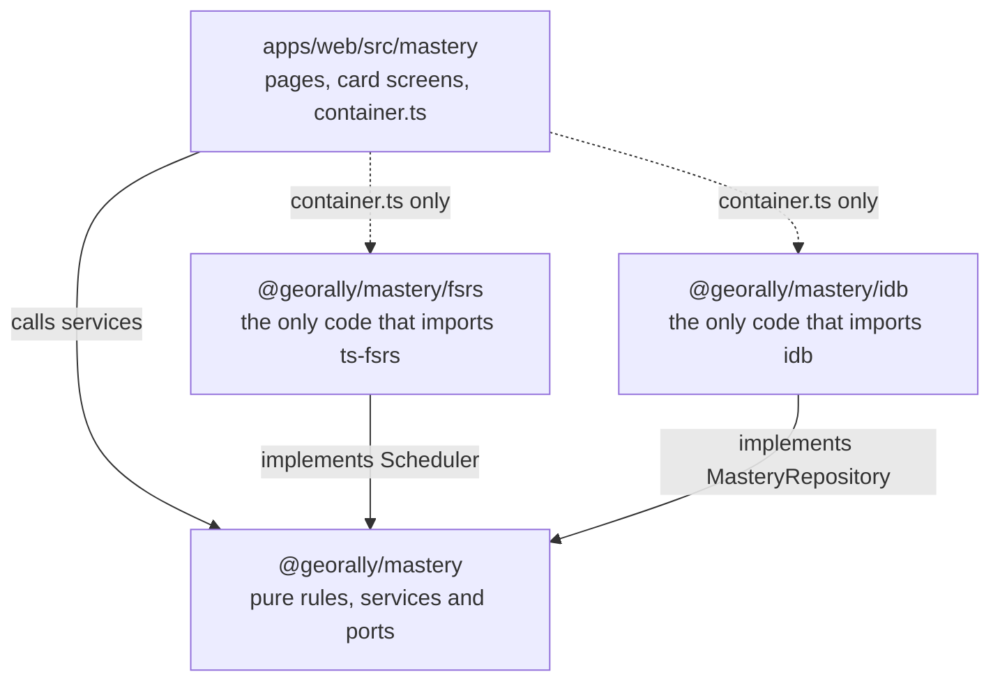
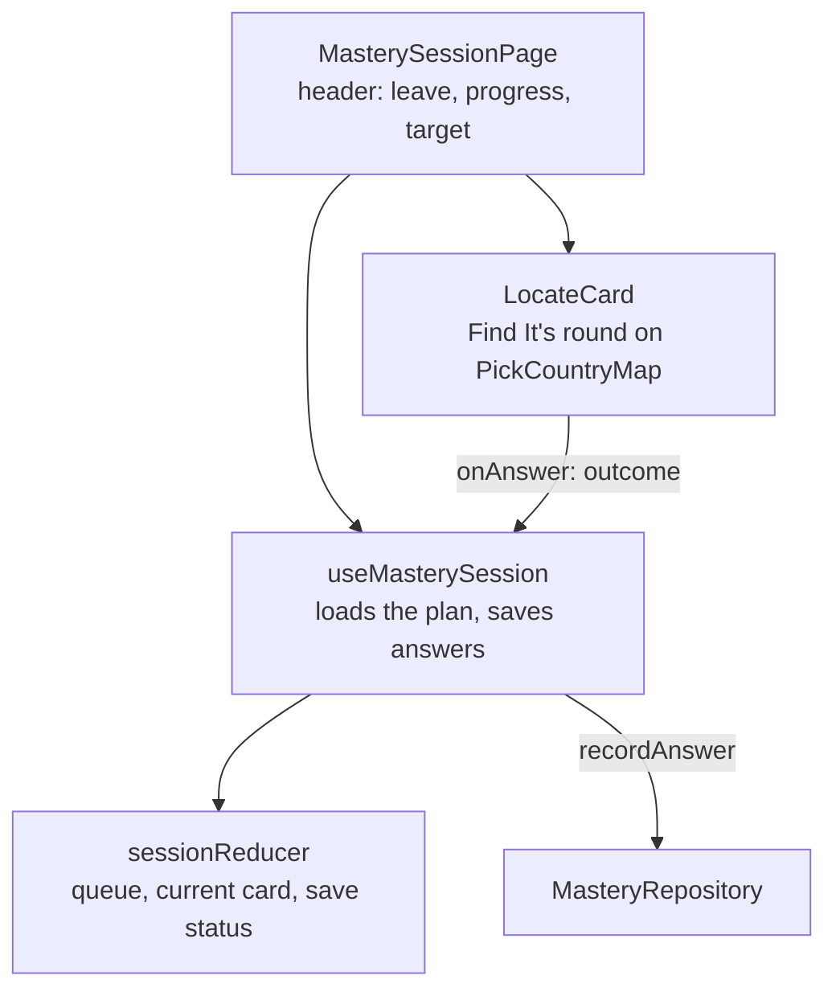

# Review (mastery)

A daily spaced-review session at `/review`. The player picks continents, and every day the session asks the countries that are due plus a few new ones, scheduled by the FSRS algorithm. Progress stays on the device, in IndexedDB, with no account.

In the interface and the URL the feature is "review". In code it is `mastery`, and its web components carry that prefix (`MasteryHomePage`, `MasterySessionPage`), because Recall Sprint already uses "review" for its results walkthrough (`useReview`, `ReviewLayers`).

Only the `locate` skill (find the named country) exists so far. The second skill, the bridge from casual games, the Overall map layer and the streak are designed in [`../proposals/mastery-review.md`](../proposals/mastery-review.md) and not built.

## Concepts

| Term          | Meaning                                                                                       |
| ------------- | --------------------------------------------------------------------------------------------- |
| Card          | A country paired with a skill, such as `417:locate`; the unit that gets scheduled             |
| Review        | One graded answer to one card, stored as a log entry                                          |
| Kind          | `new` (the card's first answer), `due`, or `recheck` (a requested early test)                 |
| Rating        | Again, Hard, Good or Easy; computed from the answer, never chosen by the player               |
| Intro plan    | The chosen continents (scopes) and a seed, which together fix the order of new cards          |
| Pace          | New cards a day and the review cap: relaxed, steady (the default) or intense                  |
| Day           | The player's local calendar date (`LocalDay` in `game-domain`: key, start, end)               |
| Mastery level | Learning, familiar or mastered, derived from a card's state; a country with no card is unseen |
| Known         | A country whose Locate card is familiar or mastered; what the map's counts count              |
| Scope         | A continent or the whole world (`GameScope`), the unit the map's counts are given for         |

## Structure

- **One package, separate from `game-domain`.** `game-domain` stays free of dependencies and holds only what the server shares. The rules, the scheduler adapter and the storage adapter live together in `@georally/mastery` with one test setup, and subpath exports keep the adapters out of the rules.
- **Ports.** The rules depend on `Scheduler` and `MasteryRepository` (`ports.ts`). The web app creates both once in `mastery/container.ts`; services take them as `MasteryDeps`. An account-backed repository can later replace the IndexedDB one without touching the rules.
- **Time and randomness are arguments.** Rules take `now` and the plan's seed. Inside `packages/mastery/src`, `Date.now()`, `new Date()` and `Math.random` are lint errors.
- **Import rules** (`eslint.config.js`):
   - only `src/fsrs/` imports `ts-fsrs`, only `src/idb/` imports `idb`, and only `src/skills/` imports a mode's reducer types;
   - in the web app, only `mastery/container.ts` imports the adapters;
   - `singleplayer-game` doesn't import from `mastery/`.
- **The rules never read the catalog.** They take a `CountryPool` or a set of ids, as `prepareQuestionSet` does.

## Data

The review log is the only primary data. Card records are a cache derived from it; mastery levels, due counts and the day's session are computed and never stored.

| Store (`georally-mastery`) | Key  | Index        | Holds                                                          |
| -------------------------- | ---- | ------------ | -------------------------------------------------------------- |
| `reviewLog`                | `id` | `reviewedAt` | Every review; entries are added, never edited or deleted       |
| `cards`                    | `id` |              | One record per reviewed card, always read whole                |
| `meta`                     | name |              | `settings`, `plan`, `rechecks`, `extraNew`, `schedulerVersion` |

- **A card has no record until its first review.** Unseen is the absence of a record, so there is no unseen level or placeholder state.
- **One function answers a card.** `answerCard(current, recheckPending, answer, scheduler)` returns the new card and its log entry: the kind (`new` without a card, `recheck` when one is pending, otherwise `due`), the rating from the skill's grader, and the next state from the scheduler. Live answers and `rebuildCards` both go through it, so a stored card and a replayed one come from the same code.
- **The log entry keeps the outcome, not just the rating** (result, response time, wrong attempts, and whether the pick was made with a mouse or by touch). A changed grader can then regrade the whole history, and the slow cap can later be tuned per device.
- **`schedulerVersion`** (`schedulerVersion.ts`) names everything that decides a card's state: the `ts-fsrs` version, its parameters and the graders. It is bumped when any of them changes. `loadToday` compares it with the stored one and, if they differ, rebuilds `cards` from the log with the current graders. So `cards` never needs a migration; only `reviewLog` and `meta` do, through numbered migrations in `idb/schema.ts`.
- **The answer is computed inside the write transaction.** `recordReview(cardId, compute)` reads the card and its recheck, runs `compute` (which is `answerCard`), and writes the card, the entry and the cleared recheck in one transaction; `replaceCards(fromLog, version)` does the same for a rebuild. A session works from a plan built when it opened, and with review open in two tabs both plans can hold the same new card. IndexedDB never interleaves two write transactions on a store, even across tabs, so the second tab's answer reads the first tab's card, is logged as `due`, and is scheduled from it. Had the kind been taken from the plan, the stored card and a replay of the log would disagree.
- **`compute` must be synchronous.** IndexedDB commits a transaction as soon as it has no pending request, so awaiting anything else inside it ends the transaction early. This is also why the adapter uses `idb` rather than hand-written promise wrappers.
- **Unreadable records are skipped, never deleted.** Every read checks its records with hand-written guards (`idb/guards.ts`), for the reason [`singleplayer.md`](singleplayer.md#saved-games) gives. A log entry from a newer app version (an unknown skill or answer shape) is skipped by the rebuild but kept, so an older app never breaks on a newer log and loses nothing. A card whose country left the catalog is ignored by plans and the map, not deleted.
- **Every order is total.** Entries with the same `reviewedAt` replay by id, and due cards with the same `due` are planned by id, so the same data always gives the same cards and the same session.
- **A newer version in another tab wins.** The database closes itself when another tab needs to upgrade it, so an old tab can't block a migration.

## Grading and scheduling

The player never picks a rating. The mode's reducer resolves the round, the skill turns the revealed round into an outcome and a rating, and the scheduler turns the rating into the next due time.

- **A card is a one-question game in the mode's own reducer.** `locate` runs Find It's `reduceGameState` with one question and one attempt. One pick is deliberate: a second try after seeing the wrong country highlighted is recognition, not recall.
- **Grading rests on correctness.** For `locate`, response time includes panning and pinch-zooming, which measure the device and the camera more than memory, so time only marks an answer slower than 20 s (`LOCATE_SLOW_MS`).

   | Outcome                                | Rating |
   | -------------------------------------- | ------ |
   | Wrong or given up                      | Again  |
   | Correct after a wrong attempt, or slow | Hard   |
   | Correct on a new card                  | Easy   |
   | Correct otherwise                      | Good   |

   Easy on a new card lets a country the player already knows skip the same-day steps: it was tested cold and answered at once. New cards are never shown before they are asked, so one rule covers a known country (answered once, back in about a week) and an unknown one (missed, shown, drilled).

- **FSRS through `ts-fsrs` 5.4.2** (FSRS-6), behind `Scheduler` in `fsrs/fsrsScheduler.ts`. Version 6 of the library moves to FSRS-7 with a new API; upgrading changes only this adapter plus a `schedulerVersion` bump.

   | Parameter           | Value    | Reason                                                                                                     |
   | ------------------- | -------- | ---------------------------------------------------------------------------------------------------------- |
   | `request_retention` | 0.9      | Cards come due when the chance of recall falls to 90%                                                      |
   | `maximum_interval`  | 365 days | Every country is seen at least once a year                                                                 |
   | `enable_short_term` | true     | FSRS owns the minute-scale steps for new and missed cards, so the session needs no re-ask rules of its own |
   | `enable_fuzz`       | false    | Scheduling stays deterministic, which the log replay depends on                                            |
   | Weights             | defaults | No training on a player's own history                                                                      |

## The day's session

A session is computed from storage every time it opens and is never saved, so closing the tab mid-session loses nothing and needs no recovery code. Each answer is stored the moment it is given.

- **The day** is computed in the web app (`shared/time/localDay.ts`) from local midnights through the `Date` constructor, so a day on a clock change is 23 or 25 hours long.
- **New cards come in the intro order** (`introOrder`): each chosen scope in turn, easy countries first, then medium, then hard, shuffled within a tier by the plan's seed. Several continents picked together are one scope, so all their easy countries come before any medium one. Cards that already exist are skipped after the shuffle, not before it, so introducing a card leaves the rest of the order in place. Scopes only grow; due cards come whatever their continent, since a card left out of a session would go overdue.
- **The plan** (`buildSessionPlan`) is built once when the session opens:
   1. cards with a recheck, oldest request first, outside the caps;
   2. due cards (`due` before the day ends), earliest first, up to the review cap minus today's `due` entries;
   3. the head of the intro order, up to the day's new cards plus today's extra ones (`extraNew`) minus today's `new` entries.

   Counting today's entries lets a second session on the same day continue where the first left off. New cards are spread evenly among the due ones, centred, so a new card near the start leaves room for its minute-scale steps before the session ends.

   | Pace    | New cards a day | Review cap |
   | ------- | --------------- | ---------- |
   | Relaxed | 5               | 30         |
   | Steady  | 8               | 60         |
   | Intense | 12              | 80         |

   "Learn 5 more" (`learnMore`) adds 5 to today's extra new cards; an extra granted on another day counts as none. It is offered only while the chosen scopes still have cards not yet introduced (`unseenCards`, the intro order minus existing cards).

   The cap grows with the pace because the review load grows with the rate of new cards: a fixed cap would turn the intense pace into a backlog that never clears. The values come from the long-run simulation (`pnpm --filter @georally/mastery simulate`), which plays 120 days per pace, with and without a 10-day break.

- **The queue** (`selectNext`, `applyAnswer`) picks the next card after every answer: a waiting card whose `due` has passed, else the next planned card, else the earliest waiting card shown early, else the session is complete. An answered card waits only if it is due again within 15 minutes (`LEARN_AHEAD_MS`); otherwise it has left the session. So a miss comes back a few cards later and again at the end, the spacing FSRS asked for.

## Web feature

`apps/web/src/mastery/` has three lazy pages: `/review`, `/review/play` and `/review/map`. If IndexedDB is unavailable (some private modes), each shows an "unavailable" screen; casual modes are unaffected.

**Entry and identity**

- **The header links to review on every page that has it** (`app/ReviewLink.tsx`), except the review pages themselves. It lives in `app/` because `shared/` doesn't import features. On phones it is the icon alone, next to the menu button; from `sm` up it adds "Review" in the logo's outlined lettering, a little apart from Install, Feedback and the language, so it reads as a section rather than a utility. Hovering fans the cards out.
- **The review emblem** (`mastery/shared/CountryCardsIcon.tsx`) is a hand of three country cards in the logo's style: filled, with white outlines and an ink drop to match the header's white menu stripes. On the review home and the summary it replaces the logo next to the header title (`PageShell`'s `headerEmblem`), and still links home.

**Home** (`MasteryHomePage`)

One card, in one of two forms:

- **First run** (`ScopeForm`): "Where do you start?" with the continent map (`ScopePicker` on the shared `ContinentMap`), a "Whole world" toggle, the pace and Start. Start stays disabled until something is picked; it saves the first scope and opens the session.
- **Later:**
   - **Today** (`TodayPanel`): the due and new counts, the pace and Start. When nothing is left, "Done for today" with how many cards are due tomorrow, and no pace: a change would only show in tomorrow's plan.
   - **The map preview** (`MapPreview`): the whole world on `MasteryMap`, with "My map" and the known count of all playable countries, linking to the map page.
   - **"Where next"** (`ScopeForm` again), only when every chosen country has been introduced and continents remain. Before that, adding a continent would change nothing for days, since new cards still come from the earlier scopes. Continents already chosen are shown fixed and can't be removed.
- **The pace** (`PaceSetting`) saves itself on every change (`setPace`) and reloads today's plan, so the counts follow at once.

**Session** (`MasterySessionPage`)

- **The card owns its mode's round; the session only sees outcomes.** `LocateCard` runs Find It's reducer and reports `onAnswer(outcome, at)`. The session reducer holds the queue, the current card and whether its answer is saved, and knows nothing about any mode, so a second skill adds a card component, not branches in the session. Next and Give up live in the card because where they go depends on how the card is answered (Find It floats them over the map; Name It has an answer bar). Leaving and the progress counter live in the page header, the same for every card.
- **Next waits for the save.** The answer is written before the queue moves on, so the queue and storage never disagree. If the write fails, a toast offers a retry with the same entry id, and the card stays.
- **One map for the whole session.** `PickCountryMap` stays mounted and resets its view for every card, so there is no reload between cards. The target's name appears only once the map is ready, since the response time starts then.
- **Feedback:** the answered country turns green or red, the camera flies to the right one, and its `CountryInfoCard` opens (the map's toggle hides it). The player moves on with Next; nothing advances by itself, so a player reading the card is never cut off.
- **Progress** counts answers given out of answers given plus cards still to come, so the total grows by one when a miss comes back.
- **Tiny countries** have pickable rings (`TinyCountryRings` in `PickCountryMap`). Every tiny country among the pickable ones is ringed, not only the target, so the rings never give the answer away.

**Summary** (`SessionSummary`)

- **It shows the whole day, not the session.** `loadDayResult` reads today's log: a card introduced today counts as new however often it came back, and any other card answered today counts as reviewed. A count kept in the session would split a day played in two sittings, and would count a missed new card's repeat as a review.
- **The map** (`mastery/map/MasteryMap.tsx`) colours every seen country by its Locate level and outlines today's countries. It opens on the continents answered today and doesn't pan or zoom, so the page scrolls over it on phones.
- **Levels** come from `deriveMastery`: learning until the card graduates from FSRS's short-term steps, then familiar, and mastered from a stability of 21 days. A card is also fading when its recall chance is under 0.85. `MasteryLayers` draws them on both maps: one fixed fill layer and a white hatch for fading (`masteryStyles.ts`), driven by a feature state per country, so a change repaints one country without rebuilding the style. Tiny countries get rings in their level's colour.
- **"Learn 5 more"** appears while the chosen scopes still have unseen cards (`loadDayResult` returns `unseenCount`). It grants five more new cards for today and starts the new session on the same page: `MasterySessionPage` remounts its session with a new key, so the plan is built again. If saving fails, a toast says so and the summary stays.
- **`navigator.storage.persist()`** is requested here, after the player has stored progress (see [`persistence.md`](persistence.md#review-progress)).

**Map page** (`MasteryMapPage`)

- **A full-screen flat map** (`ExploreMap`) with every seen country coloured by its Locate level, unseen ones grey and the latitude lines hidden (`prepareMasteryMap`). It pans and zooms freely; the back button returns to the review home.
- **The headline** names the focused scope and its known count out of its playable countries ("Europe 12/45"). `summarizeLayer` counts every scope at once over `playableCountryPool`.
- **The continent row** at the bottom picks the focus: the whole world and each continent as a shape, the chosen one lit in its colour and the rest grey with their counts. Choosing one flies the camera to it, framed between the headline and the row. The shapes come from `virtual:region-map` (`REGION_SHAPES`): each continent projected alone and framed by its own outline, leaving out islands under 0.4% of its largest landmass, so outliers such as the Aleutians don't shrink the shape. The row is centred with auto margins inside its scroller, so on narrow screens its start stays reachable.
- **Tapping a country** opens its card (`MasteryCountryCard`): the flag and name, the level, fading, and the next review in local days ("today", "tomorrow", "in 5 days"). A country with no card says "Coming up" when it is planned (`isPlanned`: its continent is in a chosen scope, or its card was accepted from a casual game's miss) and "Not in your review" otherwise.
- **The maps fade in once styled.** MapLibre paints the base style before the mastery layers and feature states apply, so both mastery maps keep the canvas transparent over the sea colour until the first `idle` after load (`useShownWhenStyled`), then fade it in.

**Analytics** (`shared/analytics/track.ts`): `review_session_start` (due and new counts), `review_card_answered` (skill, rating, kind, input, response time) and `review_session_end` (cards, new cards, duration).

## Testing

The rules take time and storage as inputs, so they are tested in the package's Vitest without a browser: the grader against real revealed states from Find It's reducer, the scheduler adapter by snapshot, the intro order, `isPlanned`, the known counts, the plan, the queue, `answerCard`, `rebuildCards`, the day summary, the IndexedDB repository against `fake-indexeddb`, and the services. The long-run simulation runs in the suite with loose bounds; its script prints the table the paces were set from. `apps/web` has no test runner.
