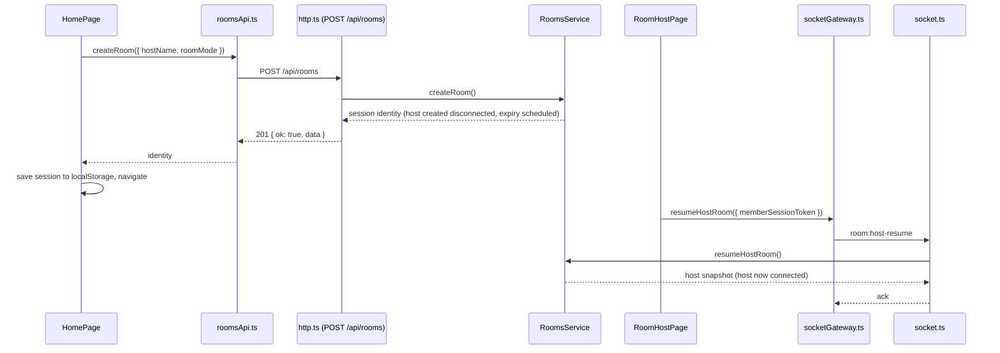
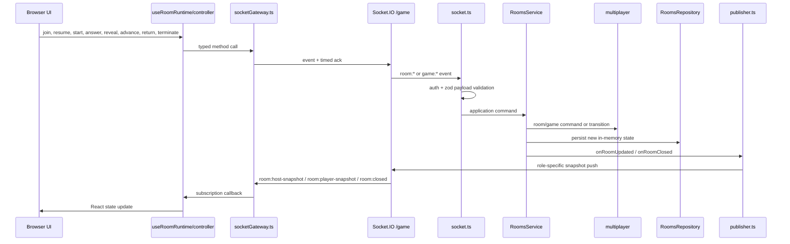
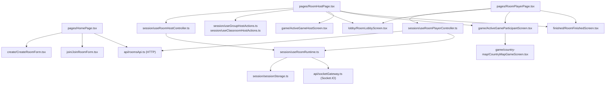
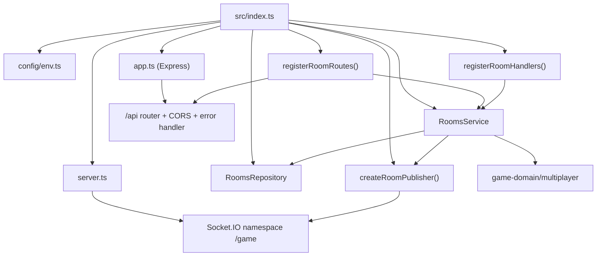
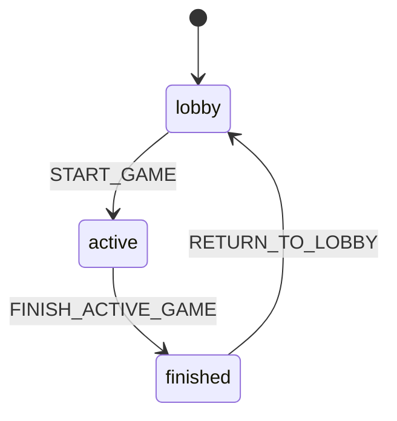
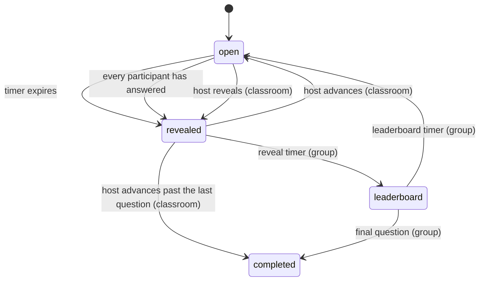
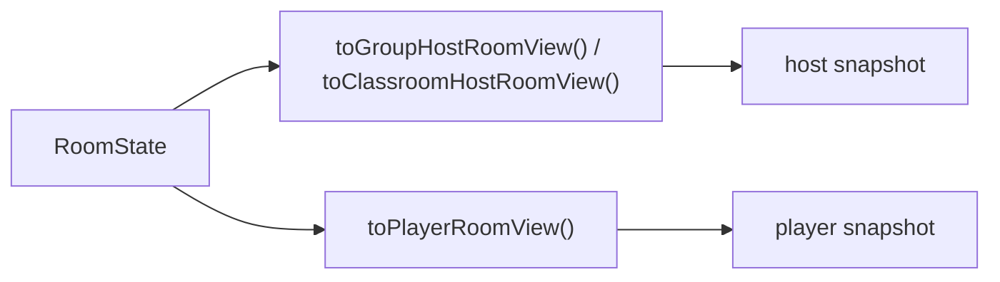

# Multiplayer

Multiplayer rules live in `packages/game-domain/src/multiplayer` (the room and game state machines). The server in `apps/server` hosts rooms in memory and talks to browsers over a small HTTP API and a Socket.IO namespace.

Multiplayer is split into four layers:

1. Browser pages, room controllers, and game screens.
2. The client transport boundary: `roomsApi.ts` (HTTP) and `socketGateway.ts` (Socket.IO).
3. Server HTTP routes and socket handlers, `RoomsService`, `RoomsRepository`, and the publisher.
4. Shared domain/protocol packages.

- [Transports](#transports)
- [End-to-end sequence](#end-to-end-sequence)
- [Client split](#client-split)
- [Server room subsystem](#server-room-subsystem)
- [Room and game state model](#room-and-game-state-model)
- [Protocol boundary](#protocol-boundary)
- [View projection model](#view-projection-model)
- [Important behavior notes](#important-behavior-notes)

## Transports

| Transport                     | Used for                                                       | Why                                                                                 |
| ----------------------------- | -------------------------------------------------------------- | ----------------------------------------------------------------------------------- |
| HTTP (`/api`)                 | Creating a room, looking up a room for the join screen         | Stateless request/response with no session; no socket is opened until one is needed |
| Socket.IO (namespace `/game`) | Joining, resuming, every in-room action, and all server pushes | A member's session is bound to a live socket so the server can push snapshots to it |

A socket is anonymous until it joins or resumes a session. See [`connection-lifecycle.md`](connection-lifecycle.md) for how connections, reconnections, and tab takeover work across Socket.IO and the game session.

## End-to-end sequence

**Creating a room (host):**



**Joining (player):** `RoomPlayerPage` looks the room up over HTTP (`GET /api/rooms/:roomCode`) to render the join screen, then sends `room:join` over the socket. The join ack carries the first player snapshot, and the same socket keeps receiving pushes. A player with a stored session resumes with `room:player-resume` instead.

**In-room actions and pushes:**



## Client split



**Important client behavior:**

- Host and player room sessions are persisted in `localStorage`. The saved session contains the room code, room ID, member ID, role, and `memberSessionToken`.
- Reconnect/resume uses `memberSessionToken`, not `socket.id` (which changes on every reconnection).
- `useRoomRuntime` centralizes connection status: connecting, ready, reconnecting, closed, and error. After a dropped connection it waits for Socket.IO to reconnect and then resumes once; if the server evicted the socket because another tab took the session, it stops with an error instead.
- The host can start a game, return a finished room to the lobby, or terminate the room. In group mode the host also answers; in classroom mode the host reveals and advances rounds.
- Players can join from a code or link and resume when a valid saved session exists.

## Server room subsystem



**Server responsibilities:**

- `app.ts` — Express app: `/health`, and an `/api` router with CORS, `Cache-Control: no-store`, JSON body parsing, and a final error handler.
- `http/responses.ts` — shared helpers that send the `Ack<T>` body over HTTP with a matching status code, and the error handler that turns malformed JSON into `invalid_payload` and anything else into `internal_error`.
- `features/rooms/http.ts` — HTTP routes: `POST /api/rooms` and `GET /api/rooms/:roomCode`.
- `features/rooms/socket.ts` — validates socket payloads with zod, checks socket authentication, delegates to `RoomsService`, binds sockets to sessions on join/resume, evicts a replaced socket on tab takeover, and returns typed acks.
- `features/rooms/service.ts` — creates, joins, resumes, starts games, submits answers, reveals/advances classroom rounds, returns finished rooms to the lobby, closes rooms, handles disconnects, and schedules timed transitions and expiry.
- `features/rooms/repository.ts` — stores rooms by ID/code, member sessions by token, socket ⇄ session bindings, and scheduled transition and expiry handles.
- `features/rooms/publisher.ts` — converts internal room state into host/player views and emits only the appropriate snapshot type to each bound socket.
- `server.ts` — creates the HTTP server and the Socket.IO `/game` namespace with typed event maps.

## Room and game state model

`multiplayer` separates room state from active game state.

**Room phases:**



**Game phases inside an active room:**



The room stores membership, host identity, connection state, and game history. The active game stores the chosen game config, generated questions, participant scores, round deadlines, submissions, reveal state, and final leaderboard.

A room created over HTTP starts with its host **disconnected**: no socket exists yet. The host becomes connected when the host page resumes over the socket. Expiry is scheduled at creation, so a room whose host never connects is closed after `ROOM_NO_CONNECTED_MEMBERS_TTL`.

## Protocol boundary

`@georally/game-protocol` is the typed contract between browser and server. Runtime payload validation is done with zod request schemas in `requests.ts`, event names and typed callbacks live in `events.ts`, and response/event payload types live in `responses.ts`.

**HTTP endpoints** (prefix `/api`):

| Method and path        | Purpose                            | Success                                                       |
| ---------------------- | ---------------------------------- | ------------------------------------------------------------- |
| `POST /rooms`          | Create a room                      | `201` with the host's session identity (no snapshot)          |
| `GET /rooms/:roomCode` | Look up a room for the join screen | `200`; a missing room is `exists: false`, not an error status |

Errors use `400` for `invalid_payload` (including malformed JSON), `500` for `internal_error`, and `422` for domain errors. Clients read the body, not the status.

In production, nginx limits `POST /api/rooms` to 10 requests per minute per client IP (bursts of up to 5 are allowed) and answers `429` beyond that, before the request reaches the server. That response is nginx's HTML error page, not an `Ack` body, so the client shows its generic connection error. Lookups are not limited: a whole classroom behind one school IP looks up the same code at once.

**Client → server socket events:**

- `room:join`
- `room:host-resume`
- `room:player-resume`
- `room:return-to-lobby`
- `room:terminate`
- `game:start`
- `game:submit-answer`
- `game:reveal-round` (classroom host)
- `game:advance-round` (classroom host)

**Server → client push events:**

- `room:host-snapshot`
- `room:player-snapshot`
- `room:closed`

**Ack shape** — every socket ack and every HTTP response body uses:

```ts
type Ack<T> = { ok: true; data: T } | { ok: false; error: RoomProtocolError }
```

The transport contract is: validate request payloads at the server edge, return typed success payloads, return typed protocol/domain errors instead of throwing exceptions across the wire, and push room updates as role-specific snapshots rather than raw internal state.

**Socket authentication rules:**

- `room:join` is rejected on a socket that is already bound to a session.
- `room:host-resume` / `room:player-resume` are rejected on a socket bound to a _different_ session; resuming the same session again is allowed (reconnects rely on it).
- Every other event requires a bound socket and acts on that socket's session.

## View projection model

The server never sends raw `RoomState` to browsers. It projects one internal room into a view for a specific member.



Host views can include all evaluated submissions after reveal or leaderboard. Player views focus on the viewer's own submission and only show leaderboard data once the game phase allows it.

## Important behavior notes

- Host and player sessions are persisted in browser `localStorage`.
- Reconnect/resume uses `memberSessionToken`, not `socket.id`. Socket.IO's `connectionStateRecovery` is intentionally off; see [`connection-lifecycle.md`](connection-lifecycle.md).
- Opening the same session in a second tab moves the session to the new tab and disconnects the old one, which then stops instead of reconnecting.
- Server state is in memory only — a server restart invalidates all live room state.
- On shutdown, the service emits `room:closed` with reason `server_shutdown` before closing Socket.IO.
- Host and player receive different projections of the same room state via `visibility.ts`.

See [`persistence.md`](persistence.md) for what that in-memory-only design implies for scaling.
