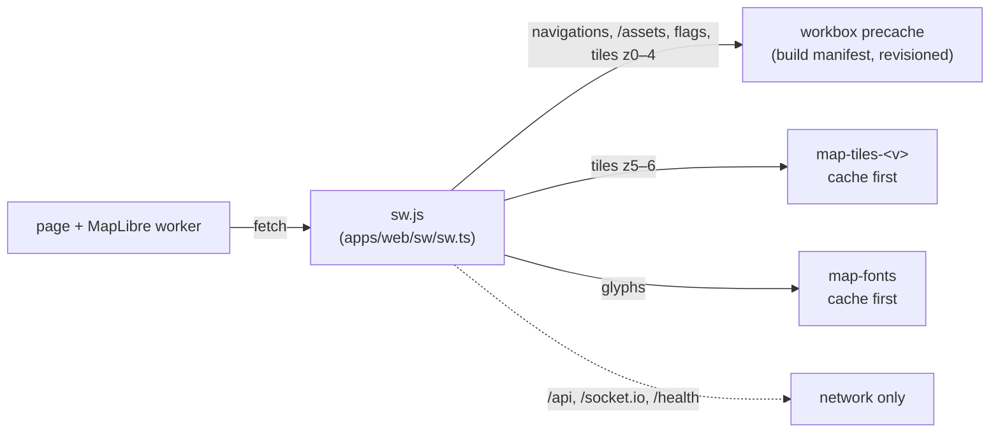

# Installable app (PWA)

GeoRally can be installed to the home screen and opens full screen. After the first visit it loads from the device, and single-player works offline. Multiplayer always needs the network.

## Pieces

- **Manifest:** `public/manifest.webmanifest`. It has one `id` and `start_url` of `/` for all languages. The worker answers `/` with the main shell, and `LocaleGate` then redirects to the player's saved or detected language. So an installed app opens in the language the player last chose, not the one they installed from, and per-locale manifests aren't needed.
- **Service worker:** `apps/web/sw/sw.ts`. `vite-plugin-pwa` builds it in `injectManifest` mode into `dist/sw.js`.
  - It is a hand-written worker, not the generated one, because navigation has to copy nginx's locale mapping (below).
  - It is type-checked by `tsconfig.sw.json`, which uses the `WebWorker` lib. The DOM and WebWorker libs can't share one program.
- **Client:** `src/shared/pwa/`.
  - `serviceWorker.ts`: registration, update checks and the update prompt state.
  - `install.ts`: the install prompt and standalone detection.
  - `useOnline.ts`
  - `AppUpdateNotice` and `InstallAppButton`

## Caching

- **Precache.** The build manifest (`globPatterns` in `vite.config.ts`) covers:
  - every HTML entry, including the three locale shells;
  - `/assets/**`;
  - the app icons;
  - every flag (195 files, about 1 MB gzipped);
  - map tiles for zoom 0–4 (335 files, about 2.3 MB).

  The Rubik Arabic and Hebrew subsets are left out because no locale uses them. That's about 6 MB in total (608 files), downloaded in the background on the first visit. Hashed assets the page already loaded come from the HTTP cache.
- **Navigations** copy `nginx.conf` and never hit the network:
  - `/en|ru|uz/...` → the precached `locales/<lang>.html`
  - `/` → `index.html`, through Workbox's `directoryIndex`
  - anything else → `index.html`
  - `/api/`, `/socket.io/`, `/health` and paths with a file extension are left alone.
  - Serving the cached shell (app-shell model) keeps the HTML and its hashed assets from the same build. A new build reaches players only through the update flow below.
- **Map tiles.** MapLibre requests tiles as `/map/tiles/{z}/{x}/{y}.pbf?v=<hash>`. The `v` comes from `05_make_tilesjson.mjs` and changes with the tile contents.
  - Precache lookups ignore `v`. Precached tiles are revisioned by their file hash, so a rebuilt tile set updates with the worker.
  - Zoom 5–6 tiles are cached on first view in `map-tiles-<v>`. When a worker with a new `v` activates, it deletes the older `map-tiles-*` caches. Without the version in the cache name, old tiles would stay for good, because each cache is bounded only by the tile set itself (≤ 3,359 files, 15 MB).
  - Requests from MapLibre's Web Worker go through the service worker too.
  - The tiles are gzip on disk and served with `Content-Encoding: gzip`. The browser decodes them before caching, so cached responses replay correctly.
- **Glyphs** (`/map/fonts/**`) are cached on first use in `map-fonts`. The files never change.
- **Flags are precached.** All 195 (`flags/*.svg`, about 1 MB gzipped) are served from our origin (see [Flags in data-pipeline.md](data-pipeline.md#flags)). They are precached up front rather than on first view, because any country can come up in an offline round or review. When a flag fails to load anyway, `FlagImage` renders nothing instead of a broken image.

## Updates

- `registerType: 'prompt'`: a new worker installs in the background and then waits. It never takes over a running page by itself, so a deploy can't reload a game.
- The app checks for a new worker hourly and whenever it becomes visible again (`visibilitychange`), while online. An installed app can stay open for days.
- `AppUpdateNotice` shows a toast with an "Update" button. It is mounted only on the home page, the single-player setup pages and the multiplayer home page, so it never appears inside a game or a room, and it is dismissed when the player leaves those pages. If the player ignores it, the new worker takes over the next time every GeoRally tab is closed.
- "Update" sends `SKIP_WAITING`. The page reloads on `controllerchange`. workbox-window's own reload only runs when the page was already controlled at registration, which isn't true in a session that started on the very first visit.
- The worker calls `clients.claim()` on activation, so runtime caching starts on the first visit, not after a reload.
- `nginx.conf` serves `/sw.js` with `Cache-Control: no-cache`, so the browser always checks it for changes.
- **Kill switch:** if a broken worker ever ships, build once with `selfDestroying: true` in the `VitePWA` options. That worker unregisters itself and clears its caches on every device.

## Offline and standalone behaviour

- Multiplayer home shows an offline notice, and the create and join buttons are disabled while `navigator.onLine` is false. Rooms already have their own reconnect notices.
- In standalone mode the page doesn't overscroll, so pull-to-refresh and the bounce don't fight map panning. Game frames already lock this through `useDocumentScrollLock`.
- Buttons and links use `touch-action: manipulation`, so fast taps in the answer bars never zoom.
- The viewport keeps the default `viewport-fit`, so iOS keeps content out of the notch and home-indicator areas. Game screens paint the document background (`useDocumentBackground`), so those strips match the screen. Opting into `viewport-fit=cover` would mean adding safe-area padding to every edge-anchored HUD and answer bar.
- `interactive-widget` stays at its default because `useKeyboardInset` already follows the on-screen keyboard through `visualViewport`.
- iOS standalone has no back button, so every screen needs its own way out. Single-player games have an exit in the HUD, setup and join pages have a back link, and the finished and closed room screens link home. **Gap:** a player in a multiplayer lobby or a running game has no in-app exit (only the host can close the room), so in the installed app on iOS their only way out is closing the app.
- iOS gives an installed app its own storage, so the language, saved rooms and reaction counters from Safari don't carry over.

## Install prompt

- On Chromium browsers, `beforeinstallprompt` is captured and an "Install" button appears in the header row (`AppHeader`), before Feedback. It is passive, so it is never a prompt, and it shows on every page with the header. On phones it is icon-only, like Feedback. To fit the row at 360 px, the language switcher drops its globe icon on phones ("RU ⌄" still reads as a language picker), and the logo is `shrink-0`, so it can't be squeezed under the buttons.
- In iOS Safari there is no install event, so the same button opens a two-step "Share → Add to Home Screen" dialog. It is hidden when the app already runs standalone. Other iOS browsers are left out because their Share menu sits elsewhere and the steps would be wrong.
- Analytics: the `app_installed` event, and a `display_mode` user property (`standalone` / `browser`) set on every load.

## Checking it

There's no Lighthouse PWA category any more. Use `pnpm build:web && pnpm preview:web` (open it on a phone through the trycloudflare host) and the Application panel in Chrome DevTools: the manifest, the worker, Cache Storage and the Offline toggle. The dev server doesn't register the worker.
