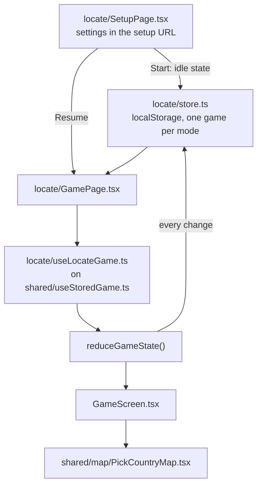
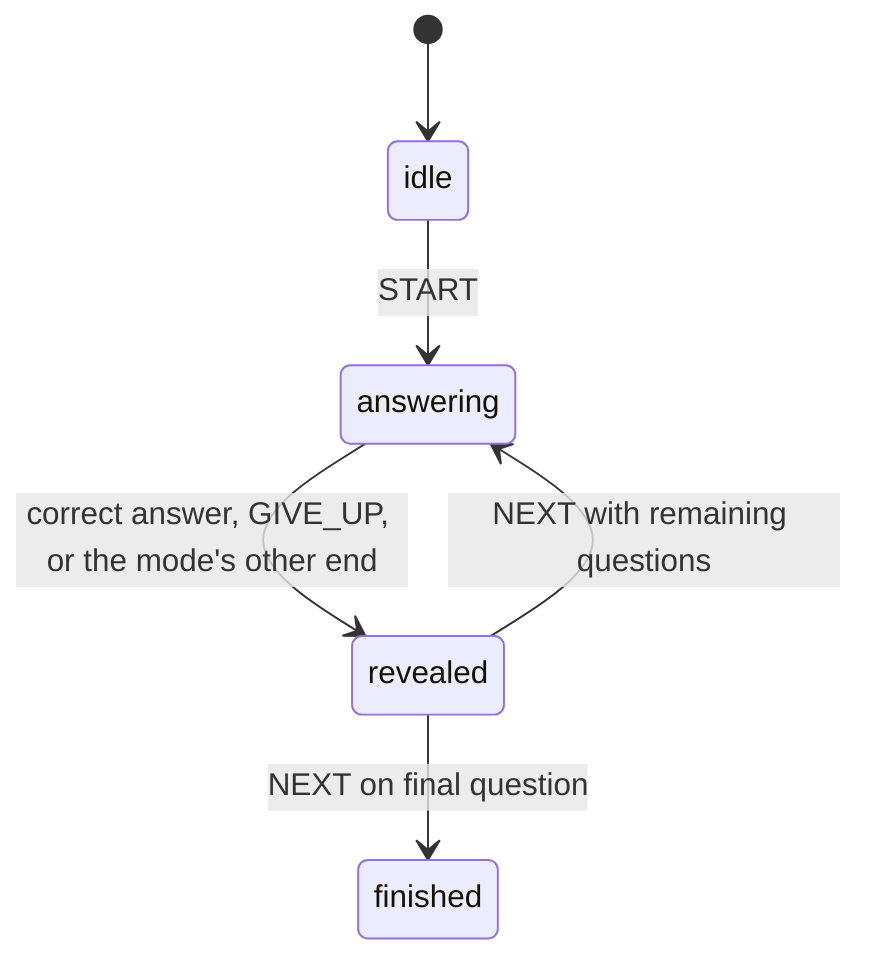

# Singleplayer

Singleplayer is fully local in the browser. It does not connect to the server.

## Flow

## Saved games

A game survives a refresh: the stored game is the only source of a game in progress, and the play URL carries nothing.

- **One game per mode,** under `georally.singleplayer.<mode>`, wrapped in `{ version, savedAt, game }`.
- **`game` is the engine state itself.** The setup page saves the idle state (`createIdleState(config)`). The game page's hook picks the questions (`prepareGameSession`) and dispatches `START`, so loading the map doesn't count against the first answer, then saves the state after every change. Questions are picked in one place: the hook, for both a new game and "Try again".
- **The setup page prevents settings that can't be played.** Several combinations have fewer eligible countries than the smallest question count (Oceania easy has 2), so the setup page disables them instead of failing after Start. A preparation failure on the game page can then only mean a stale save, which is discarded.
- **Derived data isn't stored.** The eligible set (which countries the map lets you click) is recomputed from the config and the catalog.
- **A record is discarded, not repaired,** when it can't be parsed, its version differs, it's older than 7 days, its config fails `isGameConfig`, its phase or question index is invalid, or any question is no longer in the eligible set derived now (a catalog change between deployments). The rest of the engine state is trusted: `version` must be bumped whenever an engine state's shape changes.
- **The checks are hand-written, not a Zod schema.** A schema would validate the whole state and catch a forgotten version bump at compile time, but it makes the singleplayer page load Zod's shared chunk (about 40 kB gzipped; `zod/mini` saves only 6 kB because the core is shared with multiplayer's Zod) to validate one record, and the checks that matter relate fields to each other and to the catalog, which a schema needs custom refinements for anyway.
- **The setup page offers Resume or Discard** for a game in progress and can't start another until one is chosen. A saved idle or finished game counts as none there.
- **The finished game is kept until the player leaves the results,** so a refresh on the results still shows them. "Try again" replaces it with a new game of the same settings; "Home" clears it.
- **Exiting from the header keeps the game,** so it can be resumed.
- **Times are absolute,** so a refresh pauses nothing and can't buy time.
- **Setup links keep working:** the setup page reads its settings from its own query string, and the copy-link button shares it. An old play link without a saved game redirects to setup with its query string, which prefills the form.
- **Storage that is blocked or full** only costs the refresh-survival: every storage call is guarded.
- **A game page that crashes discards its saved game** (`GameErrorBoundary`) and offers the settings, so a record that passes the checks but still breaks the game can't trap the player in a crash on every visit. It is a component boundary because the app's router is not a data router, so a route `errorElement` would never be used.

## Engines

Each mode has its own pure reducer in `packages/game-domain/src/singleplayer/`: `locate/` (find the named country on the map) and `name-it/` (name the highlighted country; the engine exists, the web app doesn't use it yet). Neither reads the clock: every action carries `now`.

Both modes share one shape, defined in `singleplayer/rounds.ts`, together with the selectors that only read it:

- Phases: `idle` → `answering` ⇄ `revealed` → `finished`.
- Every started state holds `config`, `questionIds`, `index`, `score` and `correctCount`.
- A round (`answering` and `revealed`) adds `startedAt`; a revealed round adds `outcome`, its `points` and `resolvedAt`.
- `createIdleState(config)` and `reduceGameState(state, action)` have the same names in both modes; `START`, `GIVE_UP` and `NEXT` behave the same way.

**Locate.** `PICK` answers. A wrong pick is recorded on the round (`wrongPicks`); the round ends as `outOfAttempts` once `attemptsPerQuestion` wrong picks are used. A correct pick scores `50 + 50 × (time left of a 30 s window)`, minus 10 per wrong pick, never below 0, so a correct answer is always worth at least 30 with the default three attempts.

**Name It.** `ATTEMPT` carries a `MatchResult` from the answer matcher ([`answers.md`](answers.md)) and the input method. A wrong attempt is recorded on the round (`attempts`) and costs only time; a correct one scores `50 + 50 × (time left / time limit)`. The round ends as `timeUp` at its deadline: `TIME_UP` before the deadline is ignored, and an attempt arriving at or after it resolves as `timeUp`, so the order of the timer and the input never matters. Attempts with an input method the config doesn't allow are ignored.

## Name It in the browser

- **The timer starts when the target is on screen.** The hook (`name-it/useNameItGame.ts`) keeps a saved idle game idle and prepares its questions; the map flies to the first target and, once the camera settles, calls `begin()`, which dispatches `START`. After a reveal, Next first flies the camera to the next target and dispatches `NEXT` when it settles. "Try again" goes back to idle (`RESTART`, a web-only action) with freshly prepared questions, so it follows the same path. A camera that never settles still continues after 4 s. A restored game doesn't wait: its deadline is absolute.
- **Framing** (`shared/map/camera/useFitCamera.ts`): the overlays (the top row and the answer panel) become the map's own padding, and the camera fits the target's catalog bounds inside the rest with a fifth of the free space on each side, so neighbours stay visible. MapLibre centres the fit in the padded area, so the target sits exactly at the map's centre. The map always fills the whole screen, under the phone keyboard and the toolbar iOS floats above it; only the answer panel rises, flush with the top of the keyboard (`useKeyboardInset`, from the visual viewport; 24 px above the screen edge when the keyboard is closed), and that height joins the bottom overlay, so the camera eases the target into the space still visible. Shrinking the screen to the keyboard instead resized the map, which moved it twice on every keyboard change and fought iOS's own scrolling. Page scrolling is locked while the game is open (`useDocumentScrollLock`), which also undoes the scroll iOS applies to keep a focused input visible. A change of the overlays or of the map's size re-frames the camera at once with a short ease; a keyboard animation fires many such changes, and each new ease simply continues from where the camera is, so the target follows the keyboard. A running flight is never interrupted: changes during it are ignored, and the camera re-frames once when it lands if the overlays changed meanwhile; so it re-frames when the keyboard opens, closes or changes layout, and on the reveal, which brings back the framed view if the player zoomed; the info card appears only once that reveal framing has settled. The fit stops at zoom 5.5, so tiny countries stay in context; a target smaller than 14 px after the fit gets a pulsing ring at its centroid.
- **Flights between rounds** use MapLibre's own arc (zoom out, then in) with a speed instead of a fixed duration, so a hop to a neighbour is short and a hop across the world is longer but readable. `maxDuration` is not used: a flight over it doesn't get capped, it jumps.
- **Zoom only, no panning:** there is nothing to find by panning, and a stray drag while typing would lose the target. Scroll and pinch zoom around the centre, which is the target's centre, between zoom 1 and 6 (the tiles' last level: past it, shapes only get blockier); rotation, pitch, double-click zoom and keyboard panning are off. MapLibre's own constraint is replaced (`setTransformConstrain`) by one that keeps the centre where the fit put it: by default, zooming far out pulls the centre towards the equator to hide the space beyond the poles, and zooming back in around that moved centre loses the target. MapLibre draws nothing there, not even its background colour (it fills only the world's tiles), so the game screen's own background, the map's water colour (`WATER_FILL`), shows through. The replacement still clamps the zoom to the map's limits, because the default constraint is also what enforces `minZoom` and `maxZoom`: without the clamp the map zooms out without end. A pan box per round was the alternative, but MapLibre keeps the camera inside `maxBounds` on every frame, so moving the box each round would make the flights snap.
- **The map gives nothing away:** no country or capital labels until the reveal, no clicking, and no header naming the country. Every country stays dimmed for the whole game, so the scene doesn't flicker between rounds; the target gets its sunflower fill (fading in) and thick outline only once the camera has settled on it for that round, so neither a flight nor a restore shows it early.
- **Two layouts** arrange the same parts (`name-it/layouts/`), chosen by `(pointer: coarse)`, so a narrow desktop window keeps the desktop layout and a tablet gets the touch one. Each layout also tells the camera its overlay heights, and draws the map's flat/globe and info-card toggles wherever it wants: their state lives in `RoundScreen`, not in the map (`BaseMap` takes the projection as a prop), so only MapLibre's own zoom buttons are placed inside the map (`navigationTop`, hidden on touch screens). Each layout has its own answer bar (`DesktopAnswerBar`, `TouchAnswerBar`) on a shared `useAnswerField`, rather than one bar full of variants. `useRoundView` holds the round's camera and highlight state and `useAnswerInput` the input's, so the parts share one state wherever they sit.
- **Desktop:** a timer bar along the top edge, the leave button under it on the left, the question chip ("3/10") opposite, Give up (a flag icon) under the chip, and the answer bar at the bottom with the microphone, or Next on the reveal, inside it.
- **Touch screens:** a flat bar across the full width at the top: no border and no 3D edge, only a soft shadow, so the timer is truly its bottom part (an 8 px strip along the bar's rounded bottom; it freezes on the reveal, turning grey so it never contradicts the outcome, and refills during the next flight, like the desktop bar); on the reveal the whole bar takes a faint green or coral tint; the progress sits at its right end, the leave button under it on the left and the map's toggles under it on the right, and the feedback chip drops down from under it, between them. The score banner takes that same strip on the reveal (the chip only shows while answering), at 60% size, so it stays clear of the target and its info card. The flat bar has no focus ring: its input is always focused on touch screens, so a ring would be permanent. At the bottom centre, above the keyboard, the main button: the microphone while answering, a solid 3D button that pops in once the camera has settled and shows sound bars while listening, Next on the reveal, in the same spot, with Give up as a smaller button beside it rather than under it, where stray taps land. The map's zoom buttons are hidden (pinch zooms) and its remaining buttons start below the input row.
- **The screen** has no header. The timer refills while the camera flies to the next country, so each round counts down from full; the answer bar slides in once, when the game screen opens, and stays for the whole game (see [`answers.md`](answers.md#input-in-the-game)). A visually hidden heading announces the question, and the answer on the reveal, to screen readers. A hidden info card stays hidden for the rest of the game (component state, not stored).
- **Answers** come from `shared/answers`: one matcher for the app, `useTypedAnswer` for typing and `useSpeechRecognition` for push-to-talk voice. The behaviour is described in [`answers.md`](answers.md#input-in-the-game).
- **The deadline** is a timer set to the absolute deadline (`useDeadline`); the engine ignores an early `TIME_UP`, so timer jitter does no harm.

## File responsibilities

- `singleplayer-game/modes.ts` — the mode registry: each mode's id and its lazy setup and game pages. `routes.tsx` turns it into `/singleplayer/<mode>` and `/singleplayer/<mode>/play`, and redirects the old `/singleplayer` and `/singleplayer/play` (keeping the query string) to the first mode. `paths.ts` builds a mode's paths for links.
- `singleplayer-game/<mode>/` — everything one mode owns: its setup page, game page and screen, config (setting options, the setup URL's query string, `isGameConfig`), saved-game store and game hook. Modes never import each other.
- `singleplayer-game/shared/` — only what is mode-agnostic: `gameStore.ts` (`createGameStore`, and `hasValidQuestionProgress` for modes with a question set), `useStoredGame.ts` (restore or start from idle, save every change, the `restored` flag), `questionCountFit.ts`, and the error boundary and screen, result modal and resume card. A piece moves here only when it carries no mode knowledge; each mode keeps its own header and screen.
- `singleplayer-game/shared/components/` — `SetupShell` (page frame and `ModeTabs`, which keep region and difficulty when switching modes), `SetupCard` (title row, Copy setup, Start and the not-enough-countries message), the resume card, result modal, and error boundary and screen. `useRoundEvents.ts` turns state changes into start, reveal and finish events for analytics, respecting a restored game.
- `singleplayer-game/locate/components/` — `GameHeader.tsx` (question progress, the target and the round's elapsed time) and `Hearts.tsx` (remaining attempts).
- `packages/game-domain/src/singleplayer/rounds.ts` — the phases, state shape and selectors both modes share.
- `packages/game-domain/src/singleplayer/<mode>/session.ts` — chooses the questions from the country pool (`prepareQuestionSet`).
- `packages/game-domain/src/singleplayer/<mode>/engine.ts` — the mode's reducer.
- `packages/game-domain/src/singleplayer/<mode>/score.ts` — the mode's scoring, built on `shared/score.ts` (`speedScore`).
- `shared/map/PickCountryMap.tsx` — the pick-a-country map used by locate and multiplayer. It only composes parts: `BaseMap` (the map itself, its style and projection), camera hooks, the picking hook, layer groups and the reveal popup. A mode with a different map, such as Name It, composes its own from the same parts. Labels are shown only for the country ids the composer passes to `LabelLayers`, never inferred from highlight tones.

See [`README.md`](README.md) for how this fits into the wider app.
