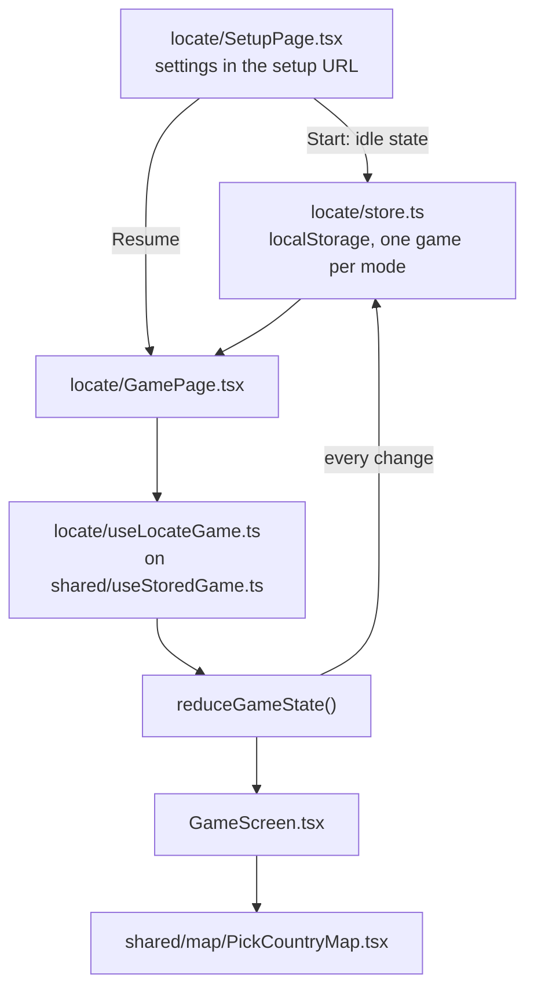
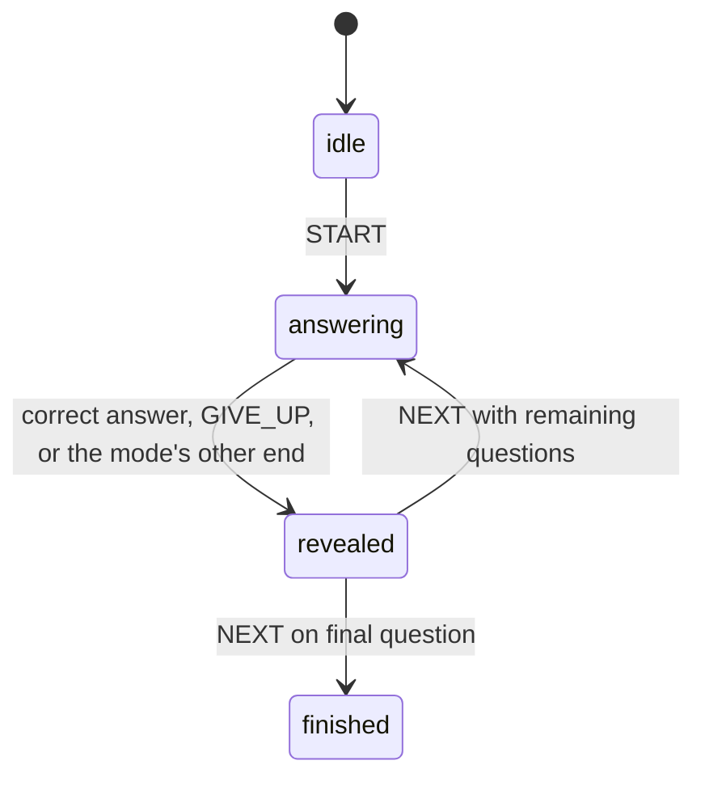

# Singleplayer

Singleplayer is fully local in the browser. It does not connect to the server.

## Modes

Each mode has its own doc for its rules, engine and browser behaviour:

- [Find It](singleplayer/find-it.md): find the named country on the map.
- [Name It](singleplayer/name-it.md): name the highlighted country.
- [Recall Sprint](singleplayer/recall-sprint.md): name a whole region from memory.
- [Routes](singleplayer/routes.md): connect two countries through the ones between them.

## Flow

## Saved games

A game survives a refresh: the stored game is the only source of a game in progress, and the play URL carries nothing.

- **One game per mode,** under `georally.singleplayer.<mode>`, wrapped in `{ version, savedAt, game }`.
- **`game` is the engine state itself.** The setup page saves the idle state (`createIdleState(config)`). The game page's hook picks the questions (`prepareGameSession`) and dispatches `START`, so loading the map doesn't count against the first answer, then saves the state after every change. Questions are picked in one place: the hook, for both a new game and "Try again".
- **The setup page prevents settings that can't be played.** Several combinations have fewer eligible countries than the smallest question count (Oceania easy has 2), so the setup page disables them instead of failing after Start. A preparation failure on the game page can then only mean a stale save, which is discarded.
- **Derived data isn't stored.** The eligible set (which countries the map lets you click) is recomputed from the config and the catalog.
- **A record is discarded, not repaired,** when it can't be parsed, its version differs, it's older than 7 days, its config fails `isGameConfig`, its phase or question index is invalid, or any question is no longer in the eligible set derived now (a catalog change between deployments). The rest of the engine state is trusted: `version` must be bumped whenever an engine state's shape changes.
- **The checks are hand-written, not a Zod schema.** A schema would validate the whole state and catch a forgotten version bump at compile time, but it makes the singleplayer page load Zod's shared chunk (about 40 kB gzipped; `zod/mini` saves only 6 kB because the core is shared with multiplayer's Zod) to validate one record, and the checks that matter relate fields to each other and to the catalog, which a schema needs custom refinements for anyway.
- **The setup page offers Resume or Discard** for a game in progress and can't start another until one is chosen. A saved idle or finished game counts as none there.
- **The finished game is kept until the player leaves the results,** so a refresh on the results still shows them. "Try again" replaces it with a new game of the same settings; "Home" clears it.
- **Exiting from the header keeps the game,** so it can be resumed.
- **Times are absolute,** so a refresh pauses nothing and can't buy time.
- **Setup links keep working:** the setup page reads its settings from its own query string, and the copy-link button shares it. An old play link without a saved game redirects to setup with its query string, which prefills the form.
- **Storage that is blocked or full** only costs the refresh-survival: every storage call is guarded.
- **A game page that crashes discards its saved game** (`GameErrorBoundary`) and offers the settings, so a record that passes the checks but still breaks the game can't trap the player in a crash on every visit. It is a component boundary because the app's router is not a data router, so a route `errorElement` would never be used.

## Loading

- **Nothing white while loading.** The play route of every mode shows `GameLoader` while the page's code downloads (the `<Suspense>` fallback in `routes.tsx`, in the main bundle, so it shows at once): a dark full-screen panel with the leave button and a loading bar. Find It's own intro then takes its place at the same spot: the same panel, leave button and bar, now with the first question above the bar. Every bar sweeps in step with the clock (its animation delay is the current time modulo the sweep), so the swap doesn't restart it. On the same timer and Start hover that prefetch the game page, the setup pages warm the HTTP cache (`shared/map/prefetchMap.ts`) with the archipelago outlines, the tiles up to zoom 2 and the glyph ranges that at least 5% of the language's country or capital labels use; rarer ranges (a dash in two Russian names, Uzbek ʻ, two English capitals) still load on demand, since each glyph file is 50–130 KB. Loading the game page also evaluates `BaseMap`, which calls MapLibre's `prewarm()`: the worker starts during setup and stays alive for the session, where MapLibre would otherwise end it with the last map and restart it, re-parsing every tile, for the next game. MapLibre has its own chunk (`manualChunks` in `vite.config.ts`), and no setup page may import a module that imports `maplibre-gl` at runtime (`shared/map/camera/framing.ts` does, for `LngLat`): Recall Sprint's setup counts its countries with `regionCountries.ts` rather than `sprintRegion.ts` for that reason, so a setup page never waits for MapLibre's 300 KB.

## Engines

Each mode has its own pure reducer in `packages/game-domain/src/singleplayer/`: `locate/` (find the named country on the map), `name-it/` (name the highlighted country), `recall-sprint/` and `routes/`. Neither reads the clock: every action carries `now`.

Find It and Name It share one round-based shape, defined in `singleplayer/rounds.ts`, together with the selectors that only read it:

- Phases: `idle` → `answering` ⇄ `revealed` → `finished`.
- Every started state holds `config`, `questionIds`, `index`, `score` and `correctCount`.
- A round (`answering` and `revealed`) adds `startedAt`; a revealed round adds `outcome`, its `points` and `resolvedAt`.
- `createIdleState(config)` and `reduceGameState(state, action)` have the same names in both; `START`, `GIVE_UP` and `NEXT` behave the same way.

Recall Sprint and Routes play one session per game instead of rounds; their engines are in their own docs.

## File responsibilities

- `singleplayer-game/modes.ts` — the mode registry: each mode's id and its lazy setup and game pages. `routes.tsx` turns it into `/singleplayer/<mode>` and `/singleplayer/<mode>/play`, and redirects the old `/singleplayer` and `/singleplayer/play` (keeping the query string) to the first mode. `paths.ts` builds a mode's paths for links.
- `singleplayer-game/<mode>/` — everything one mode owns: its setup page, game page and screen, config (setting options, the setup URL's query string, `isGameConfig`), saved-game store and game hook. Modes never import each other.
- `singleplayer-game/shared/` — only what is mode-agnostic: `gameStore.ts` (`createGameStore`, and `hasValidQuestionProgress` for modes with a question set), `useStoredGame.ts` (restore or start from idle, save every change, the `restored` flag), `questionCountFit.ts`, and the error boundary and screen, result modal and resume card. A piece moves here only when it carries no mode knowledge; each mode keeps its own header and screen.
- `singleplayer-game/shared/components/` — `GamePanel` (a dark full-screen panel on the HUD's row, and `LoadingStatus`), `GameLoader` (the play routes' loading screen), `SetupShell` (page frame and `ModeTabs`, which keep region and difficulty when switching modes), `SetupCard` (title row, Copy setup, Start and the not-enough-countries message), the resume card, result modal, and error boundary and screen; and for the modes answered by typing or voice, `KeyboardGameFrame` (the full-screen frame that locks page scrolling and keeps the phone keyboard open by cancelling every button's pointer-down), `LeaveButton` (to the given mode's setup; `tone='dark'` for dark bars), `CountdownBar`, the two microphone buttons and the voice notice. Answer bars and layouts stay in each mode, since they carry its stages. `useRoundEvents.ts` turns state changes into start, reveal and finish events for analytics, respecting a restored game.
- `singleplayer-game/locate/components/` — `GameHeader.tsx` (question progress, the target and the round's elapsed time), `Hearts.tsx` (remaining attempts), and the full-screen `RoundIntro` and `RoundPanel`, which share `RoundSplash` (the question, large). `useRoundStages.ts` sequences them with the header.
- `packages/game-domain/src/singleplayer/rounds.ts` — the phases, state shape and selectors Find It and Name It share.
- `packages/game-domain/src/singleplayer/<mode>/session.ts` — chooses the questions from the country pool (`prepareQuestionSet`).
- `packages/game-domain/src/singleplayer/<mode>/engine.ts` — the mode's reducer.
- `packages/game-domain/src/singleplayer/<mode>/score.ts` — the mode's scoring, built on `shared/score.ts` (`speedScore`).
- `shared/map/PickCountryMap.tsx` — the pick-a-country map used by locate and multiplayer. It only composes parts: `BaseMap` (the map itself, its style and projection), camera hooks, the picking hook, layer groups and the reveal popup. A mode with a different map, such as Name It, composes its own from the same parts. Labels are shown only for the country ids the composer passes to `LabelLayers`, never inferred from highlight tones.
- **Map colouring runs on feature state** (`shared/map/useFeatureState.ts`): every game layer (dimming, highlight tones, selection, hover, Name It's target outline, Recall Sprint's region, reveal and lifted look, the archipelago outlines) is a fixed spec whose paint reads `feature-state`, and the game only sets and removes per-country states, diffed against what was applied. MapLibre re-lays out every loaded tile of a source when a layer's filter or a data-driven paint value changes, so swapping a `match` over the highlighted ids or a filter on the selected id on each click re-tiled the world during flights; a state change only updates the paint buffers. Feature-state changes are not animated, so the selection fade runs on the layers' constant opacity (0 with no selection, full with one) while the state picks the country. Hidden archipelago outlines stay in the layer and still answer queries, so picking skips those without the `shown` state (`isPickableFeature`). Label layers still filter by id: hidden symbols would still take part in collision and push visible labels away.

See the [root `README.md`](../../README.md) for how this fits into the wider app.
