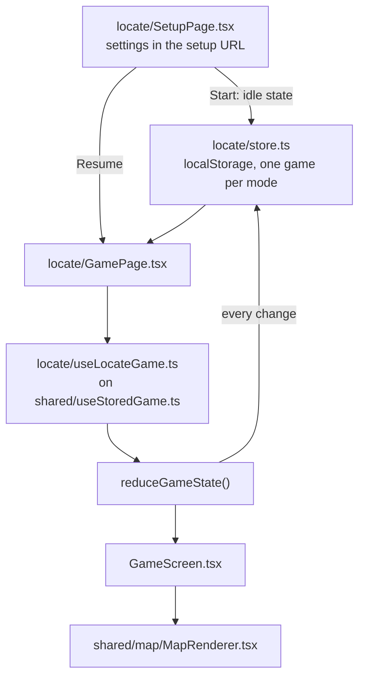
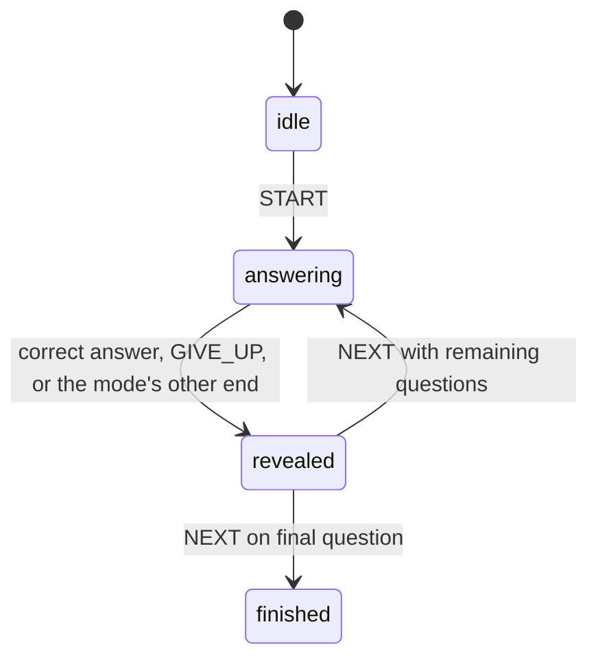

# Singleplayer

Singleplayer is fully local in the browser. It does not connect to the server.

## Flow

## Saved games

A game survives a refresh: the stored game is the only source of a game in progress, and the play URL carries nothing.

- **One game per mode,** under `georally.singleplayer.<mode>`, wrapped in `{ version, savedAt, game }`.
- **`game` is the engine state itself.** The setup page saves the idle state (`createIdleState(config)`). The game page's hook picks the questions (`prepareGameSession`) and dispatches `START`, so loading the map doesn't count against the first answer, then saves the state after every change. Questions are picked in one place: the hook, for both a new game and "Try again".
- **The setup page prevents settings that can't be played.** Several combinations have fewer eligible countries than the smallest question count (Oceania easy has 2), so the setup page disables them instead of failing after Start. A preparation failure on the game page can then only mean a stale save, which is discarded.
- **Derived data isn't stored.** The eligible set (which countries the map lets you click) is recomputed from the config and the catalog.
- **A record is discarded, not repaired,** when it can't be parsed, its version differs, it's older than 7 days, its config fails `isGameConfig`, its phase or question index is invalid, or any question is no longer in the eligible set derived now (a catalog change between deployments). The rest of the engine state is trusted: `version` must be bumped whenever an engine state's shape changes.
- **The checks are hand-written, not a Zod schema.** A schema would validate the whole state and catch a forgotten version bump at compile time, but it makes the singleplayer page load Zod's shared chunk (about 40 kB gzipped; `zod/mini` saves only 6 kB because the core is shared with multiplayer's Zod) to validate one record, and the checks that matter relate fields to each other and to the catalog, which a schema needs custom refinements for anyway.
- **The setup page offers Resume or Discard** for a game in progress and can't start another until one is chosen. A saved idle or finished game counts as none there.
- **The finished game is kept until the player leaves the results,** so a refresh on the results still shows them. "Try again" replaces it with a new game of the same settings; "Home" clears it.
- **Exiting from the header keeps the game,** so it can be resumed.
- **Times are absolute,** so a refresh pauses nothing and can't buy time.
- **Setup links keep working:** the setup page reads its settings from its own query string, and the copy-link button shares it. An old play link without a saved game redirects to setup with its query string, which prefills the form.
- **Storage that is blocked or full** only costs the refresh-survival: every storage call is guarded.
- **A game page that crashes discards its saved game** (`GameErrorBoundary`) and offers the settings, so a record that passes the checks but still breaks the game can't trap the player in a crash on every visit. It is a component boundary because the app's router is not a data router, so a route `errorElement` would never be used.

## Engines

Each mode has its own pure reducer in `packages/game-domain/src/singleplayer/`: `locate/` (find the named country on the map) and `name-it/` (name the highlighted country; the engine exists, the web app doesn't use it yet). Neither reads the clock: every action carries `now`.

Both modes share one shape, defined in `singleplayer/rounds.ts`, together with the selectors that only read it:

- Phases: `idle` → `answering` ⇄ `revealed` → `finished`.
- Every started state holds `config`, `questionIds`, `index`, `score` and `correctCount`.
- A round (`answering` and `revealed`) adds `startedAt`; a revealed round adds `outcome`, its `points` and `resolvedAt`.
- `createIdleState(config)` and `reduceGameState(state, action)` have the same names in both modes; `START`, `GIVE_UP` and `NEXT` behave the same way.

**Locate.** `PICK` answers. A wrong pick is recorded on the round (`wrongPicks`); the round ends as `outOfAttempts` once `attemptsPerQuestion` wrong picks are used. A correct pick scores `50 + 50 × (time left of a 30 s window)`, minus 10 per wrong pick, never below 0, so a correct answer is always worth at least 30 with the default three attempts.

**Name It.** `ATTEMPT` carries a `MatchResult` from the answer matcher ([`answers.md`](answers.md)) and the input method. A wrong attempt is recorded on the round (`attempts`) and costs only time; a correct one scores `50 + 50 × (time left / time limit)`. The round ends as `timeUp` at its deadline: `TIME_UP` before the deadline is ignored, and an attempt arriving at or after it resolves as `timeUp`, so the order of the timer and the input never matters. Attempts with an input method the config doesn't allow are ignored.

## File responsibilities

- `singleplayer-game/modes.ts` — the mode registry: each mode's id and its lazy setup and game pages. `routes.tsx` turns it into `/singleplayer/<mode>` and `/singleplayer/<mode>/play`, and redirects the old `/singleplayer` and `/singleplayer/play` (keeping the query string) to the first mode. `paths.ts` builds a mode's paths for links.
- `singleplayer-game/<mode>/` — everything one mode owns: its setup page, game page and screen, config (setting options, the setup URL's query string, `isGameConfig`), saved-game store and game hook. Modes never import each other.
- `singleplayer-game/shared/` — only what is mode-agnostic: `gameStore.ts` (`createGameStore`, and `hasValidQuestionProgress` for modes with a question set), `useStoredGame.ts` (restore or start from idle, save every change, the `restored` flag), `questionCountFit.ts`, and the error boundary and screen, result modal and resume card. A piece moves here only when it carries no mode knowledge; the setup layout, header and analytics stay in `locate/` until a second mode shows what is really common.
- `singleplayer-game/locate/components/` — `GameHeader.tsx` (question progress, the target and the round's elapsed time) and `Hearts.tsx` (remaining attempts).
- `packages/game-domain/src/singleplayer/rounds.ts` — the phases, state shape and selectors both modes share.
- `packages/game-domain/src/singleplayer/<mode>/session.ts` — chooses the questions from the country pool (`prepareQuestionSet`).
- `packages/game-domain/src/singleplayer/<mode>/engine.ts` — the mode's reducer.
- `packages/game-domain/src/singleplayer/<mode>/score.ts` — the mode's scoring, built on `shared/score.ts` (`speedScore`).
- `shared/map/MapRenderer.tsx` — the pick-a-country map used by locate and multiplayer. It only composes parts: `BaseMap` (the map itself, its style and projection), camera hooks, the picking hook, layer groups and the reveal popup. A mode with a different map, such as Name It, composes its own from the same parts. Labels are shown only for the country ids the composer passes to `LabelLayers`, never inferred from highlight tones.

See [`README.md`](README.md) for how this fits into the wider app.
